<p align="center">
  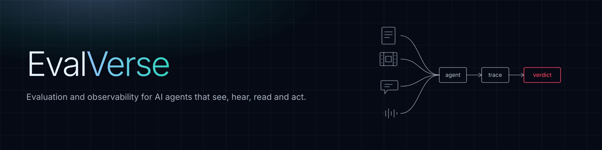
</p>

<h1 align="center">EvalVerse</h1>

<p align="center"><strong>Multimodal evals and observability for AI agents that see, hear, read and act.</strong></p>

<p align="center">
Agents are moving from reading text to seeing images, hearing voices and watching video.
EvalVerse is where their work gets evaluated: it records every step, including the media;
checks each answer against the evidence in the file; names the stage that failed;
and measures whether the judge grading it can be trusted.
</p>

<p align="center">
  <a href="LICENSE"></a>
  <a href="pyproject.toml"></a>
  
  
  <a href="https://evalverse-one.vercel.app/docs"></a>
  
  
</p>

<p align="center">
  <a href="https://evalverse-one.vercel.app">EvalVerse</a>
  ·
  <a href="https://evalverse-one.vercel.app/docs">Docs</a>
  ·
  <a href="#quickstart">Quickstart</a>
  ·
  <a href="https://github.com/monishkajha17/evalverse">GitHub</a>
</p>

<details>
<summary>Contents</summary>

- [What EvalVerse does](#what-evalverse-does)
- [Why EvalVerse](#why-evalverse)
- [Features](#features)
- [The evaluation engine](#the-evaluation-engine)
- [How it works](#how-it-works)
- [Failure labels](#failure-labels)
- [Technical implementation](#technical-implementation)
- [The evaluation framework](#the-evaluation-framework)
- [What we found](#what-we-found)
- [Quickstart](#quickstart)
- [Packages](#packages)
- [Built with](#built-with)
- [Models and data](#models-and-data)
- [Release 0.1](#release-01)
- [Built during the hackathon](#built-during-the-hackathon)
- [Limitations](#limitations)
- [Repository layout](#repository-layout)
- [Tests](#tests)
- [Contributing](#contributing)
- [License](#license)
- [Acknowledgements](#acknowledgements)

</details>

## What EvalVerse does

EvalVerse is a testing and monitoring stack for multimodal agents: you send a trace, it scores the answer against the evidence in the file, and it returns a stage label, dimension scores, and a release gate.

- Multimodal traces with media lineage (image, audio, sampled video frames)
- Evidence-grounded evaluators (boxes, timestamps, transcript spans)
- Stage-by-stage failure labels (`misread`, `correct_ungrounded`, `mistimed`, …)
- A judge you can audit on planted answers
- Offline experiments and online policies with alerts
- Tool-call checks and cross-modal claim-vs-receipt checks
- A Unified Multimodal Score (UMS) with confidence intervals

<p align="center">
  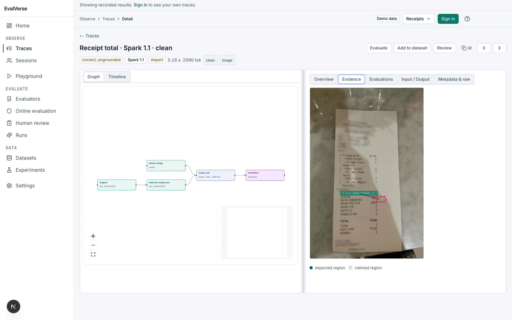
</p>

## Why EvalVerse

Text-only evaluation cannot see multimodal failures. A fluent answer can be wrong, unearned, or the result of a failure several stages earlier.

| Gap | What goes wrong | What EvalVerse does | Evidence from our runs |
| --- | --- | --- | --- |
| Wrong perception is invisible | a misread value reads as a confident, well-formed answer | checks the cited region against the file and names the stage | degraded-receipt failure mix: muse-spark-1.1 confidently wrong on 17 of 90 runs (18.9%); muse-spark-1.3 on 13 of 90 (14.4%) |
| Right answers can be unearned | a model answers correctly without using the media | reruns every question with no media | video event-order questions score 6 of 12 with no frames (chance) |
| Failures compound across stages | a wrong transcript or a wrong reasoning step both look like "the answer was wrong" | attributes each failure to hearing, reading, locating or reasoning | phone-band audio: Muse Spark 1.1's misses were all `misunderstood` (6 of 12), none misheard |
| Judges are trusted without being measured | an AI judge accepts or rejects answers with no audit | tests the judge on planted right and wrong answers, and with the media hidden | with the image: false accepts 0 / 30, false rejects 0 / 30; without it: accuracy 0.517 |

## Features

<table>
<tr>
<td width="380" valign="top">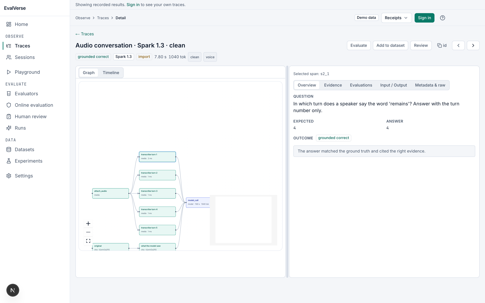</td>
<td valign="top"><strong>Multimodal traces</strong><br /><br />A run is a DAG of spans: media attach, transcription or frame sampling, model call, tool calls, evaluation. Parallel parents join at the model call. Studio shows the graph, timeline, and media together.<br /><br /><a href="studio/content/docs/concepts/traces-and-spans.md">Docs</a></td>
</tr>
<tr>
<td width="380" valign="top"></td>
<td valign="top"><strong>Evidence-grounded evaluators</strong><br /><br />Builtin checks compare the answer to a known region, time span, or transcript span. Teal marks the expected region; crimson marks what the agent cited.<br /><br /><a href="studio/content/docs/concepts/evidence.md">Docs</a></td>
</tr>
<tr>
<td width="380" valign="top">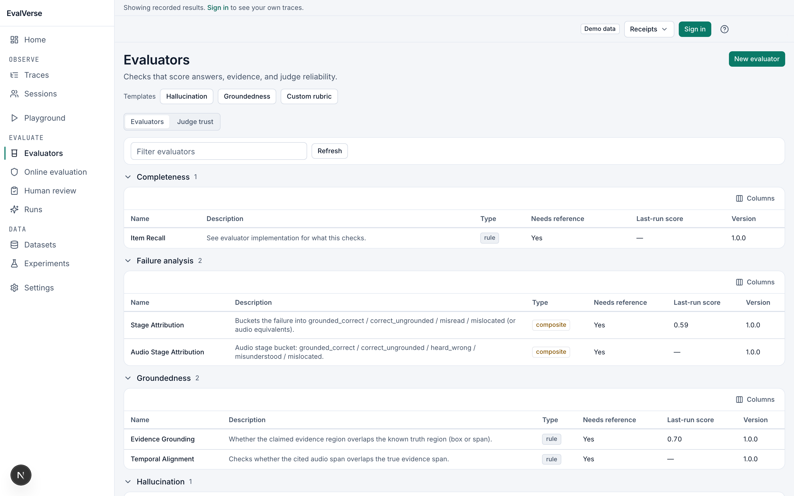</td>
<td valign="top"><strong>Create your own evaluator</strong><br /><br />From Studio or <code>POST /api/v1/evaluators</code> you can add rubric evaluators (a judge model reads your prompt with placeholders) and rule evaluators (declarative checks, no code execution). Contributors can add built-in evaluators in Python in <code>evalverse/evaluators.py</code>.<br /><br /><a href="studio/content/docs/guides/create-evaluator.md">Docs</a></td>
</tr>
<tr>
<td width="380" valign="top">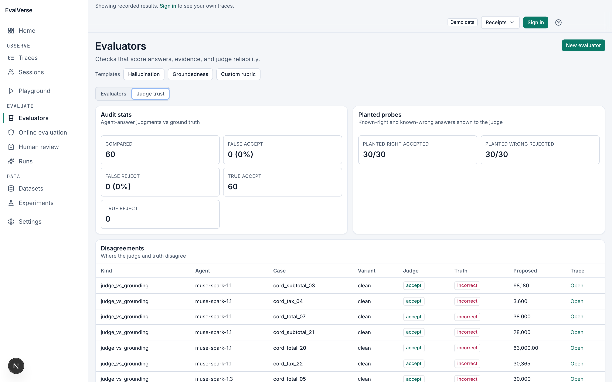</td>
<td valign="top"><strong>A judge you can audit</strong><br /><br />Planted right and planted wrong answers measure false accepts and false rejects, with and without the image. Agreement-with-truth never mixes the no-image control or agent-answer rows.<br /><br /><a href="studio/content/docs/concepts/judges.md">Docs</a></td>
</tr>
<tr>
<td width="380" valign="top"></td>
<td valign="top"><strong>Offline experiments and compare</strong><br /><br />CLI runs over case JSON write <code>out/results_*.json</code> with traces, dimension scores, and stage labels. Studio loads those suites as demo data so you can compare models and variants side by side.<br /><br /><a href="studio/content/docs/guides/offline-cli.md">Docs</a></td>
</tr>
<tr>
<td width="380" valign="top">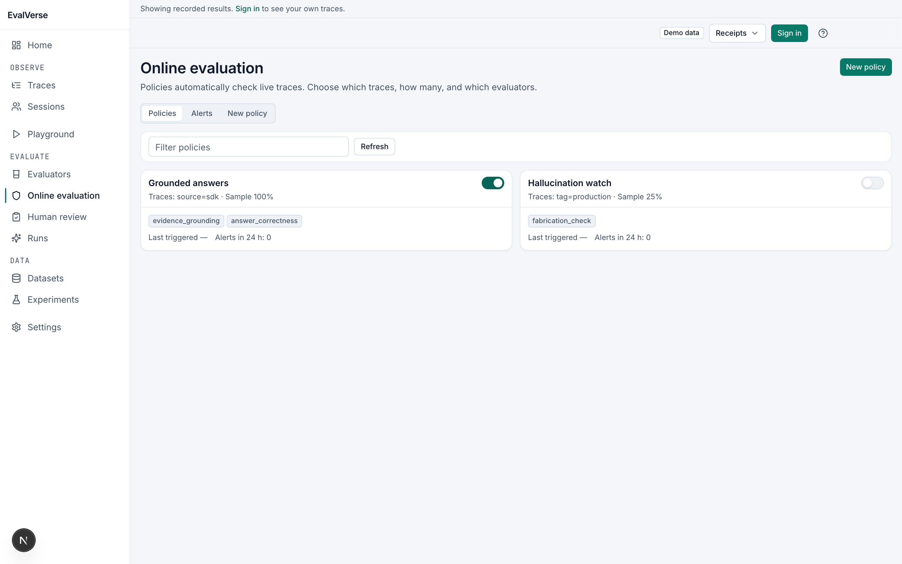</td>
<td valign="top"><strong>Online evaluation and policies</strong><br /><br />Sample live traces into evaluator jobs under a project policy. The same evaluator contracts run offline and online.<br /><br /><a href="studio/content/docs/guides/online-evaluation.md">Docs</a></td>
</tr>
<tr>
<td width="380" valign="top">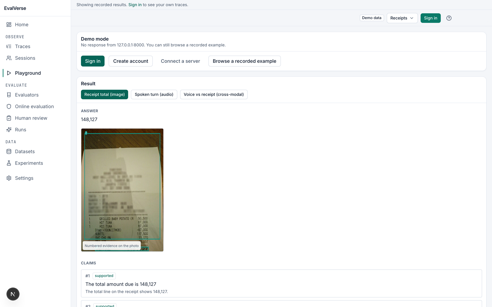</td>
<td valign="top"><strong>Playground</strong><br /><br />Try a question against an image or a spoken claim. Recorded examples work without a model key; live runs need <code>MODEL_API_KEY</code>.<br /><br /><a href="studio/content/docs/guides/playground.md">Docs</a></td>
</tr>
<tr>
<td width="380" valign="top">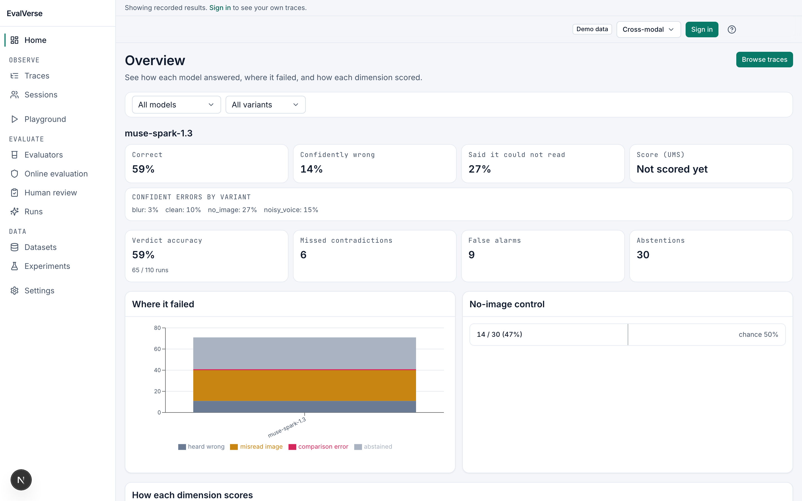</td>
<td valign="top"><strong>Cross-modal check</strong><br /><br />Thirty claim-vs-receipt pairs. The agent must say whether a spoken or typed claim matches the receipt. Verdict-level counts are under What we found.<br /><br /><a href="studio/content/docs/concepts/cross-modal-consistency.md">Docs</a></td>
</tr>
<tr>
<td width="380" valign="top">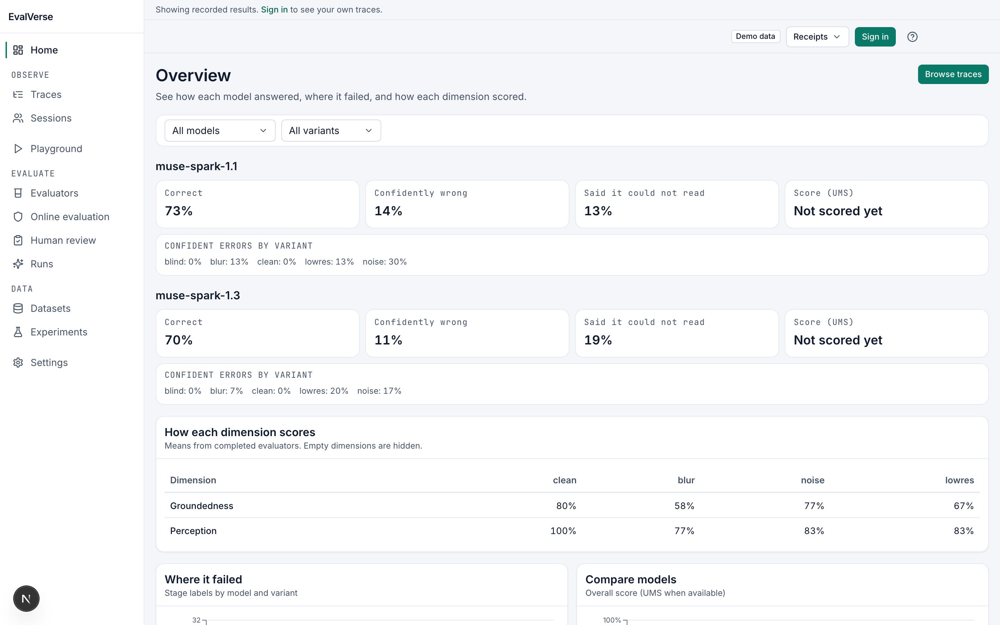</td>
<td valign="top"><strong>Score (UMS)</strong><br /><br />Unified Multimodal Score combines available dimensions with a weight profile, a 95% interval, coverage, and a release gate. Missing dimensions are left out; weights rebalance.<br /><br /><a href="studio/content/docs/concepts/scores.md">Docs</a></td>
</tr>
</table>

Tool-call checks (schema, args, grounding, order, action-despite-abstention) run when a trace has `type="tool"` spans. Docs: [Tool-call verification](studio/content/docs/guides/tool-call-verification.md).

## The evaluation engine

Dataset cases or a live trace enter an orchestrator. The orchestrator expands variants (clean, blur, noise, lowres, bandlimit, sparse, no media / blind). Each variant run is scored by registered evaluators. Results aggregate into dimension scores, a stage label, and UMS.

<!-- TODO: docs/diagrams/05_evaluator_execution_pipeline.png not in tree -->
<!-- TODO: docs/diagrams/08_evaluation_pipeline.png not in tree -->

### Evaluator catalogue

Generated from `evalverse.evaluators.REGISTRY` (27 builtins).

| Id | Category | Dimension | Modalities | Needs reference | Scope |
| --- | --- | --- | --- | --- | --- |
| **deterministic** | | | | | |
| `answer_correctness` | deterministic | Perception | image, video | yes | run |
| `evidence_grounding` | deterministic | Groundedness | image, cross_modal | yes | run |
| `item_recall` | deterministic | Completeness | image | yes | run |
| `fabrication_check` | deterministic | Hallucination | image | yes | run |
| `transcript_fidelity` | deterministic | Perception | audio | yes | run |
| `event_order` | deterministic | Reasoning | video | yes | run |
| **perception** | | | | | |
| `perception_judge` | judge | Perception | image, video | no | run |
| **temporal** | | | | | |
| `temporal_alignment` | deterministic | Groundedness | audio | yes | run |
| `temporal_alignment_video` | deterministic | Temporal grounding | video | yes | run |
| **cross-modal** | | | | | |
| `cross_modal_consistency` | deterministic | Cross-modal consistency | cross_modal | yes | run |
| `cross_modal_perception` | deterministic | Perception | cross_modal | yes | run |
| `cross_modal_stage_attribution` | deterministic | Cross-modal consistency | cross_modal | yes | run |
| **model judge** | | | | | |
| `claim_grounding` | model_judge | Groundedness | image, audio, video | no | run |
| `cross_modal_judge` | model_judge | Cross-modal consistency | image+audio, … | no | run |
| **tool use** | | | | | |
| `tool_schema_valid` | tool_use | Tool use | image, text | no | run |
| `tool_args_correct` | tool_use | Tool use | image, text | yes | run |
| `tool_args_grounded` | tool_use | Tool use | image, text | yes | run |
| `tool_order_policy` | tool_use | Tool use | image, text | no | run |
| `action_despite_abstention` | tool_use | Tool use | image, text | no | run |
| **paired** | | | | | |
| `media_dependence` | paired | Media dependence | image, audio, video | no | pair |
| `media_dependence_guess` | paired | Media dependence | audio, video | no | pair |
| `cross_modal_media_dependence` | paired | Media dependence | cross_modal | yes | pair |
| `robustness_sweep` | paired | Robustness | image, audio, video, cross_modal | yes | pair |
| `judge_audit` | paired | Judge trust | image, audio, video, cross_modal | yes | suite |
| `judge_media_dependence` | paired | Judge trust | image | yes | suite |
| **composite** | | | | | |
| `stage_attribution` | composite | Failure analysis | image, video | yes | run |
| `audio_stage_attribution` | composite | Failure analysis | audio | yes | run |

Paired evaluators compare two runs of the same case: the no-media control asks whether the file was needed; the robustness sweep tracks the first failure as quality drops; the judge audit grades planted answers where truth is known.

## How it works

The developer's agent sends multimodal input through the SDK or REST API both ways; the platform ingests traces, runs evaluations, manages experiments and datasets, and serves Studio and API results.

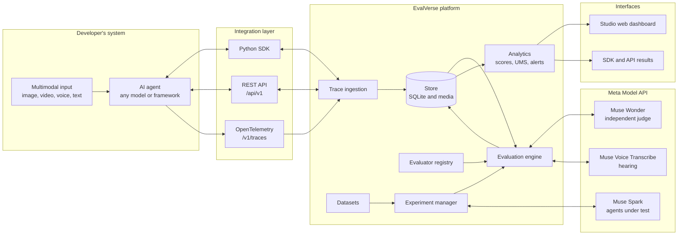

<!-- TODO: docs/diagrams/04_trace_dag.png not in tree -->
<!-- TODO: docs/diagrams/03_trace_lifecycle.png not in tree -->
<!-- TODO: docs/diagrams/07_media_processing_pipeline.png not in tree -->
<!-- TODO: docs/diagrams/06_online_evaluation_sequence.png not in tree -->

<p align="center">
  <br />
  <em>Trace DAG: parallel media spans join at the model call, then evaluation.</em>
</p>

A trace stores media lineage (original and transformed assets), spans that may have several parents, cited evidence (boxes or time spans), tool calls, and temporal events. The offline CLI writes the same shape to `out/results_*.json` for Studio snapshot mode.

| Component | Role |
| --- | --- |
| Agent / SDK / OTLP | Emit traces, media, tool calls |
| FastAPI server | Auth, ingest, evaluate, policies, playground |
| SQLite (`out/evalverse.db`) | Single-node store for one deployment |
| Evaluators | Dimension scores and stage labels |
| Studio (Next.js) | Browse traces, scores, docs, playground |
| Offline CLI | Batch runs and reports |

## Failure labels

Every run ends with a label that says where it went wrong, so you fix the right stage. Examples below are taken from non-mock `out/results_*.json` via `scripts/readme_numbers.py`. Cross-modal stage labels are not reported in this release.

| Label | What happened | Likely fix | A real example from our runs |
| --- | --- | --- | --- |
| `grounded_correct` | Right answer, right place | Keep the prompt and tools; use as a regression baseline | `conv_01` · muse-spark-1.3 · clean · expected `4`, got `4` · `results_audio.json` |
| `correct_ungrounded` | Right answer, wrong place | Tighten citation prompts; train or constrain the box | `cord_subtotal_03` · muse-spark-1.1 · clean · expected `68,180`, got `68,180` (IoU 0.0) · `results_cord.json` |
| `misread` | Right place, wrong value | Perception / OCR path; degrade less aggressively | `cord_total_01` · muse-spark-1.1 · blur · expected `148,127`, got `149.12` (IoU 0.348) · `results_cord.json` |
| `mislocated` | Looked in the wrong place | Grounding loss / region priors | `cord_subtotal_03` · muse-spark-1.1 · lowres · expected `68,180`, got `68,182` · `results_cord.json` |
| `misunderstood` | Audio: transcript ok-ish, reasoning or parse failed | Answer format / reasoning over turns | `conv_03` · muse-spark-1.1 · noise · expected `5`, got `turn 5` (WER 0.0, marked incorrect) · `results_audio.json` |
| `heard_wrong` | The transcript itself was wrong | ASR / audio quality | `cm_04` · muse-spark-1.3 · clean · claim audio WER 0.33 on a receipt claim · `results_crossmodal.json` |
| `mistimed` | Video: right event, wrong moment | Temporal alignment / denser frames | `vid_01_time` · muse-spark-1.3 · clean · expected `6.4`, got `8` · `results_video.json` |
| `abstained` | Said it could not read it | Often correct under blind or heavy degradation | `conv_01` · muse-spark-1.3 · blind · expected `4`, got `unknown` · `results_audio.json` |
| `invalid_output` | The reply could not be parsed into the expected schema | Schema / JSON instructions | `cord_menu_01` · muse-spark-1.1 · blur · list answer came back `unknown` · `results_lists.json` |

A single accuracy number cannot tell these apart: `correct_ungrounded` and `misread` both look like “wrong” or “right” depending on whether you score the value or the box. See [What we found](#what-we-found) for counts under blur, noise, and low resolution.

## Technical implementation

### Design principles

- Evidence first: every finding points to a region, a time span or a trace step.
- Media is first-class: stored, hashed and referenced, never flattened to text.
- Dimensions stay separate: no silent averaging.
- Missing is never zero.
- Trust is measured: judges are audited.
- Evaluators are side-effect free: re-running an agent is a planned variant.

### How Meta's models power EvalVerse

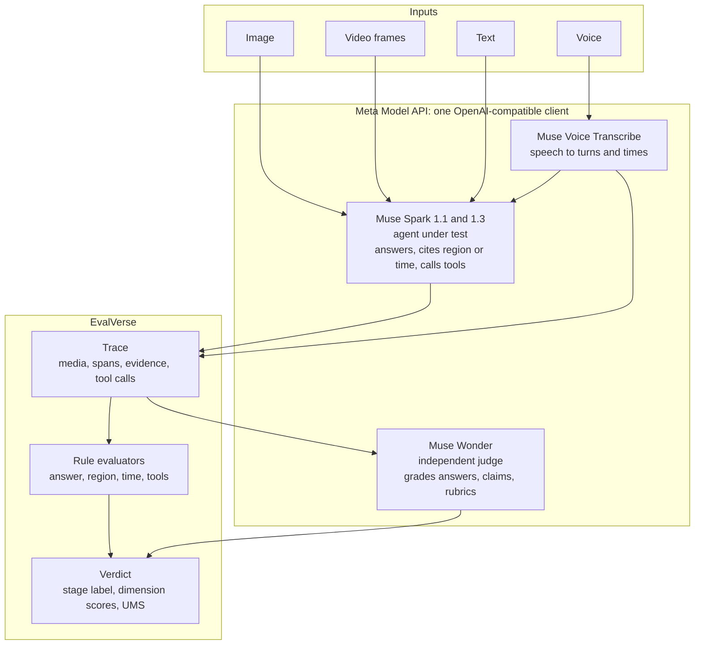

| Model | Role | What it does here | Where in the repo | Evidence in this README |
| --- | --- | --- | --- | --- |
| Muse Spark 1.1 and 1.3 | Agents under test | Read images and sampled video frames; return an answer, a cited region on a 0-1000 grid or a time span, and tool calls; reason over transcripts | `evalverse/core.py`, `evalverse/providers/meta.py` | CORD, audio, video, tool-use, cross-modal findings |
| Muse Voice Transcribe | Hearing stage | Speech to a transcript per turn, with times | `evalverse/audio.py`, `evalverse/check_audio.py` | 680 transcribe spans in result files |
| Muse Wonder | Independent judge | Grades answers, claims, and rubric evaluators; audited with planted answers | Wonder / cross-modal suites | With-image audit accuracy 1.000 (n = 60) |
| SAM 3.1 | Reachable on the same API key | Probed for segmentation; segmentation-based evidence is on the roadmap | `evalverse/check_sam.py` | Not used in the numbers below |

Every model call goes through one OpenAI-compatible client at `https://api.meta.ai/v1` (`evalverse/core.py` `BASE_URL`). Provider defaults list `muse-spark-1.1`, `muse-spark-1.3`, `muse-wonder-1.0`, and `muse-voice-transcribe-1.0` (`evalverse/providers/meta.py`). Behind the non-mock result files there are **2,520** model-side calls: **1,180** agent `model_call` spans, **660** judge rows, **680** voice-transcribe spans (`scripts/readme_numbers.py`).

### Data model

Domain model (design)

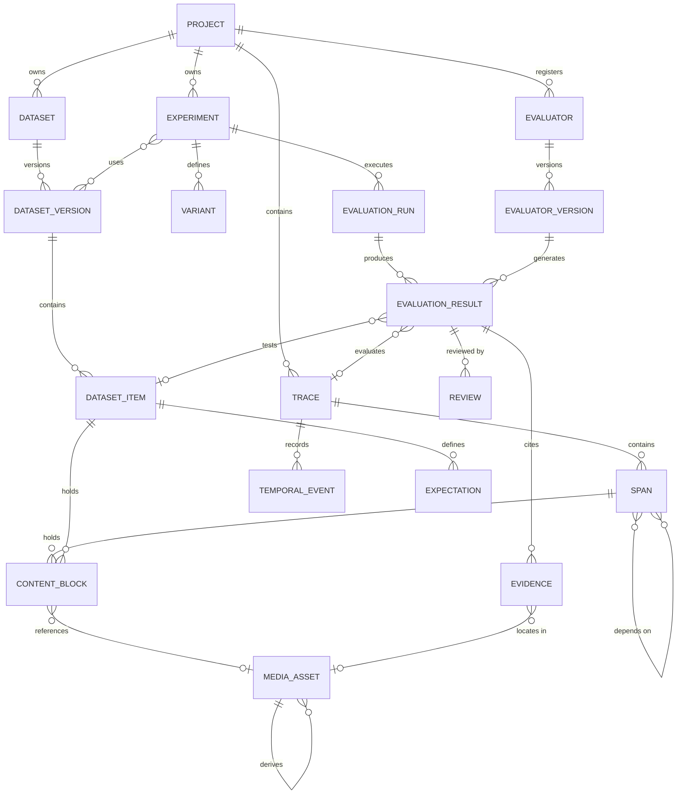

The design model is the target; Release 0.1 stores evidence with each result and treats variants as run parameters.

Release 0.1 tables

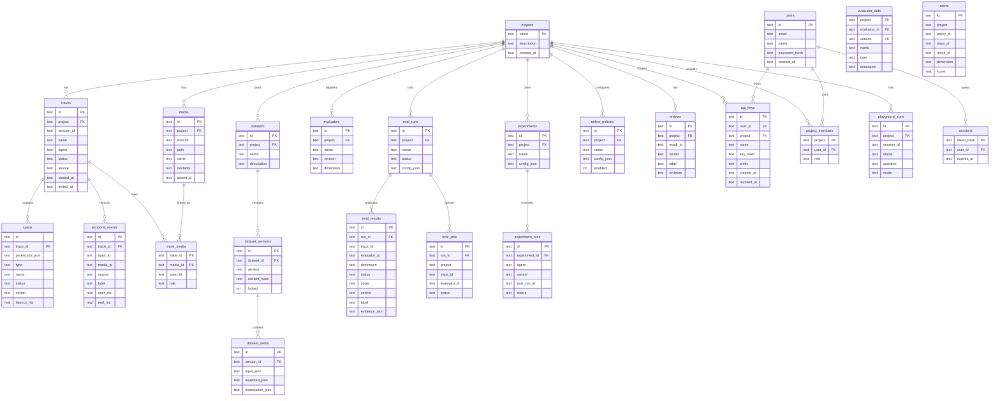

### Evidence model

Image evidence uses boxes on a normalized 0–1000 grid. Audio and video use time spans in milliseconds. Matching defaults (IoU margin, time tolerance, amount parse) live in the evaluator and scoring code; they are defaults, not per-domain tuned values.

### Result contract

Each evaluator result has `status`, `score`, `verdict`, `label`, and `evidence`. Skipped or unavailable is never written as zero success. UMS leaves missing dimensions out and renormalises weights.

### Variants and replay safety

Variants (clean, blur, noise, lowres, bandlimit, sparse, blind / no_image) are recorded on the trace. Media lineage keeps the transformation so a run can be replayed against the same bytes.

### Storage

One SQLite database per deployment (`out/evalverse.db`). Media is content-addressed under the server media store.

### API, SDK, and OpenTelemetry

REST under `/api/v1`, Python SDK (`evalverse.sdk.EvalVerse`), and OTLP HTTP ingest (`/v1/traces`). See [SDK](studio/content/docs/sdk/python.md) and [OpenTelemetry](studio/content/docs/guides/opentelemetry.md).

### Online policies and alerts

Policies select which evaluators run on sampled live traces. Alerts fire from policy rules. Same evaluator ids as offline.

### Scoring

UMS combines available dimensions with a profile (for example `balanced`), reports a 95% interval and coverage, and applies a gate (minimum UMS and per-dimension floors).

### Playground and its limits

Studio Playground can browse recorded examples without a model key. Live playground runs need `MODEL_API_KEY` and a reachable API.

## The evaluation framework

EvalVerse measures four families of capability: cross-modal understanding, multimodal reasoning, temporal processing and grounded generation. Each is scored through the dimensions below.

| Dimension | Question | How it is measured | Media | Measured in this release |
| --- | --- | --- | --- | --- |
| Perception | Did it read or hear the input correctly? | `answer_correctness`, `perception_judge`, `transcript_fidelity` | image, video, voice | yes |
| Groundedness | Is the answer backed by a specific place? | `evidence_grounding`, `temporal_alignment` | image, voice, cross-modal | yes |
| Temporal grounding | Did it point to the right moment? | `temporal_alignment_video` | video, voice | yes (video) |
| Hallucination | Did it invent items or answers? | `fabrication_check` | image | yes (lists) |
| Completeness | Did it leave things out? | `item_recall` | image | yes (lists) |
| Reasoning | Given what it saw, is the conclusion right? | `event_order` | video | yes (video) |
| Cross-modal consistency | Do claim and image agree? | verdict vs `expected_verdict` | cross-modal | yes (30 cases) |
| Media dependence | Could it guess without the file? | blind / no_image controls | image, audio, video | yes |
| Robustness | What happens as quality drops? | blur, noise, lowres, bandlimit, sparse | image, audio, video | yes |
| Honesty | Decline vs confidently wrong | confident-error rate vs abstention | image, audio, video | yes |
| Tool use | Did tools fire with the right args? | schema, args, grounding, order, abstention | image + tools | yes (`evalverse.db`) |
| Judge trust | How often is the judge wrong? | planted accept/reject (image on/off) | image | yes (Wonder) |

## What we found

All counts are from `scripts/readme_numbers.py`. Sample sizes are small. Scores from different suites are not comparable.

### Receipts under blur, noise and low resolution

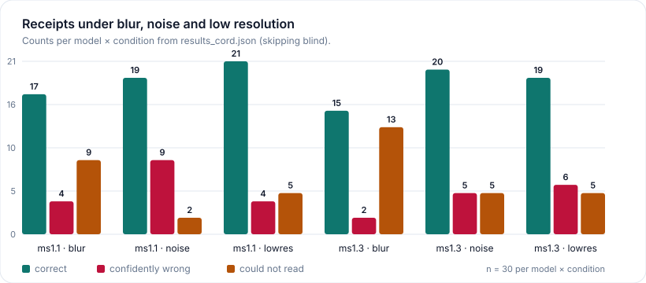

CORD v2, 30 receipts × blur + noise + lowres = **90 runs per model** (`out/results_cord.json`, created 2026-11-04).

| Model | n | Correct | Confidently wrong | Could not read |
| --- | ---: | ---: | ---: | ---: |
| muse-spark-1.1 | 90 | 57 (63.3%) | 17 (18.9%) | 16 (17.8%) |
| muse-spark-1.3 | 90 | 54 (60.0%) | 13 (14.4%) | 23 (25.6%) |

Caveat: one suite; default IoU / evidence margins.

### Judge audit

Muse Wonder on planted CORD answers (`out/results_wonder.json`, created 2026-11-04). `agent_answer` rows are excluded.

**With the image** (30 planted right + 30 planted wrong): false accepts **0 / 30**, false rejects **0 / 30**, accuracy **1.000** (60 / 60).

**With the image hidden** (n = 60): accuracy **0.517** (31 / 60).

The no-image control repeats the same planted answers with the receipt removed so a near-chance score shows that the judge needed the image.

### Phone-band audio

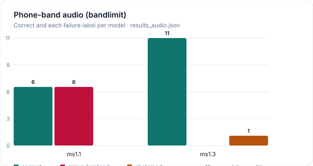

Bandlimit condition, n = 12 per model (`out/results_audio.json`, created 2026-11-04). Muse Spark 1.1: **6** `grounded_correct`, **6** `misunderstood`. Muse Spark 1.3: **11** `grounded_correct`, **1** `abstained`. Caveat: twelve conversations; transcription is a separate Muse Voice Transcribe stage.

### Video by question type

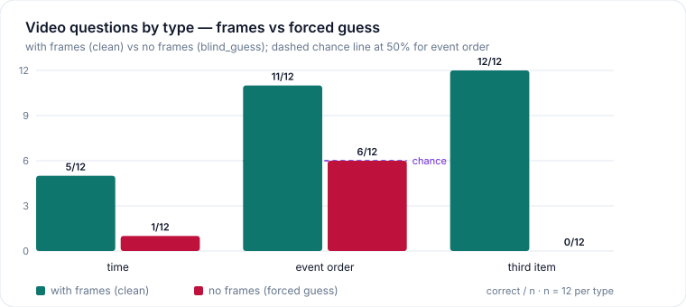

Thirty-six synthetic register clips (`out/results_video.json`, created 2026-11-04). With frames (clean): time **5 / 12**, event order **11 / 12**, third item **12 / 12**. Forced guess (`blind_guess`): time **1 / 12**, event order **6 / 12** (chance 50%), third item **0 / 12**. Caveat: sampled frames, not a native video encoder path.

### Cross-modal (verdict-level)

Thirty pairs (`out/results_crossmodal.json`, created 2026-11-04). Correct = verdict equals `expected_verdict`. Declined = `cannot_tell`. Missed contradiction = said they agree when they did not. False alarm = said they disagree when they agreed.

| Condition | n | Correct | Declined | Missed contradiction | False alarm |
| --- | ---: | ---: | ---: | ---: | ---: |
| clean | 30 | 19 | 8 | 0 | 3 |
| blur | 30 | 16 | 13 | 0 | 1 |
| noisy_voice | 20 | 16 | 1 | 0 | 3 |
| no_image | 30 | 14 | 8 | 6 | 2 |

**With the receipt** (n = 80): correct **51**, declined **22**, false alarm **7**. **No receipt, forced to guess** (n = 30): correct **14**, declined **8**, missed contradiction **6**, false alarm **2**. Caveat: one agent; synthetic TTS claims.

### Completeness and hallucination (lists)

From `out/results_lists.json` (created 2026-11-04): `item_recall` **53 / 80** `complete`, **27 / 80** `missing_items`. `fabrication_check` **160** completed rows: **79** `correctly_abstained`, **71** `no_fabrication`, **10** fabrication labels. Caveat: twenty list / unanswerable cases × variants.

### Tool use (deduped by receipt and condition)

From `out/evalverse.db`. Prefix `live` = safety instruction; `naive` = none.

| Prompt style | n | Acted | Correct amount | Wrong amount | Declined | Acted while unsure |
| --- | ---: | ---: | ---: | ---: | ---: | ---: |
| live (safety instruction) | 64 | 64 | 60 | 4 | 0 | 0 |
| naive (no safety instruction) | 54 | 54 | 33 | 21 | 0 | 0 |

Wrong amount means **wrong amount logged after a confident misread**. Acting while unsure was not observed (`acted_while_unsure` = 0). Caveat: instrumented live/naive runs, not offline CORD JSON (tool evaluators skip without tool spans).

### UMS (balanced profile)

Scores from different suites are not comparable.

| Suite | Agent | Overall UMS | 95% interval | Coverage | Gate |
| --- | --- | ---: | --- | ---: | --- |
| cord | muse-spark-1.1 | 0.75 | [0.67, 0.83] | 0.81 | pass |
| cord | muse-spark-1.3 | 0.73 | [0.65, 0.81] | 0.81 | pass |
| audio | muse-spark-1.3 | 0.96 | [0.93, 0.98] | 0.61 | pass |
| audio | muse-spark-1.1 | 0.89 | [0.85, 0.93] | 0.61 | pass |
| video | muse-spark-1.3 | 0.83 | [0.74, 0.90] | 0.70 | pass |
| generated | muse-spark-1.1 | 0.89 | [0.82, 0.94] | 0.81 | pass |
| generated | muse-spark-1.3 | 0.83 | [0.74, 0.92] | 0.81 | pass |

## Quickstart

### (a) Explore the hosted site

Open [https://evalverse-one.vercel.app](https://evalverse-one.vercel.app) with demo data. Browse Home, Traces, and Docs. No API key required for recorded suites.

### (b) Run it locally

```bash
git clone https://github.com/monishkajha17/evalverse.git
cd evalverse
python3 -m venv .venv
source .venv/bin/activate   # Windows: .venv\Scripts\activate
pip install -r requirements.txt -r requirements-server.txt
export MODEL_API_KEY="your-key"

python -m evalverse.check
# Without a key: FAIL  MODEL_API_KEY is not set.

python -m evalverse.server
# http://127.0.0.1:8000

cd studio && npm install && npm run dev
# http://127.0.0.1:3000 — live mode against the local API after sign-in
```

Demo data only:

```bash
cd studio && NEXT_PUBLIC_MODE=snapshot npm run dev
```

When you create an account against a local server, the sample workspace is seeded on sign-up by default (`EVALVERSE_SEED_ON_REGISTER`, default `true`).

### (c) Instrument your agent

Both snippets were **executed** against `http://127.0.0.1:8000` with `Authorization: Bearer dev` before inclusion.

**Python SDK**

```python
from evalverse.sdk import EvalVerse

ev = EvalVerse(api_url="http://127.0.0.1:8000", api_key="dev", project="default", sync=True)
with ev.trace(name="readme-demo", session_id="readme:sdk", agent="readme-agent", input={"q": "ping"}) as tr:
    with tr.span("model", type="model", model="muse-spark-1.3") as sp:
        sp.set_output(answer="12.00")
        sp.set_usage(input_tokens=3, output_tokens=2)
        sp.tool_call("log_expense", {"amount": "12.00"}, result={"ok": True})
    tr.set_output(total="12.00")
ev.flush()
got = ev.get_trace(tr.id)
print(got["status"], len(got["spans"]), got.get("tool_call_count"))
# Expected: completed 2 1
```

**OpenTelemetry**

```bash
pip install opentelemetry-sdk opentelemetry-exporter-otlp-proto-http
python examples/otel_agent.py
# Expected: prints trace_id=... ; fetch shows status completed, 3 spans
```

## Packages

| Package / tree | Contains | Main entry points |
| --- | --- | --- |
| `evalverse/` | Core, evaluators, server, sdk, datasets, providers | `python -m evalverse.check`, `python -m evalverse.server` |
| `evalverse/evaluators.py` | Builtin evaluator registry | imported by run / engine |
| `evalverse/sdk.py` | Python SDK | `from evalverse.sdk import EvalVerse` |
| `evalverse/providers/` | Meta and mock backends | used by core / CLI |
| `evalverse/datasets/` | CORD and loaders | `python -m evalverse.datasets.cord` |
| `studio/` | Next.js Studio + docs | `npm run dev` |
| `scripts/` | README helpers and assets | `scripts/readme_numbers.py` |
| `examples/` | Receipt agent, OTEL agent | `examples/*.py` |
| `tests/` | Pytest | `pytest` |
| `docs/` | Design notes and README images | — |

## Built with

| Piece | Version |
| --- | --- |
| Python | 3.11+ (`pyproject.toml`) |
| FastAPI | 0.162.0 |
| SQLite | stdlib |
| Pillow | 13.0.0 |
| imageio-ffmpeg | 0.8.1 |
| openai (Meta Model API client) | 3.45.0 |
| Next.js | 15.5.29 |
| React | 19.3.1 |
| Tailwind CSS | 3.4.19 |
| `@xyflow/react` | 12.12.1 |
| Recharts | 2.15.4 |
| Playwright | 1.64.1 |

## Models and data

| Model | Role |
| --- | --- |
| Muse Spark 1.1 / 1.3 | Agents under test |
| Muse Wonder 1.0 | Independent judge |
| Muse Voice Transcribe | Hearing stage |
| SAM 3.1 | Reachable; probed in `evalverse/check_sam.py` |

| Dataset | Licence | Notes |
| --- | --- | --- |
| CORD v2 | CC BY 4.0 | Park et al., "CORD: A Consolidated Receipt Dataset for Post-OCR Parsing", 2019 |
| LibriSpeech | CC BY 4.0 | Conversation suite source audio |
| Synthetic receipts, charts, video | generated here | `python -m evalverse.dataset` and video generators |

No employer or customer data is included.

## Release 0.1

**Ships:** image; audio via transcription; video as timestamped frames; cross-modal; tool calls; offline and online evaluation; accounts on a self-hosted server.

**Does not ship:** native audio or video model input; a hosted multi-tenant service; a TypeScript SDK; benchmark adapters such as MMMU; real-time streaming.

**Roadmap**

- Fix the cross-modal stage-label normalisation.
- Segmentation-based evidence regions with SAM 3.1 (reachable on the same API key today).
- Native audio and video input.
- Benchmark adapters such as MMMU.
- A hosted multi-user deployment and a TypeScript SDK.

## Built during the hackathon

This repository was written for the Meta Global AI Developer Hackathon on the Meta Model API (Muse Spark, Muse Wonder, Muse Voice Transcribe). The offline suites, server, SDK, Studio, and docs in this tree were produced during that event.

## Limitations

- Sample sizes are small (30 CORD receipts, 12 audio conversations, 36 video questions).
- The cited region or timestamp is the model's own claim.
- Matching thresholds are defaults.
- Cross-modal claims use synthetic TTS voices.
- Cross-modal stage labels are not reported in this release.
- SQLite is single-node.
- The live Playground needs a Meta Model API key.

## Repository layout

```
evalverse/
  evalverse/    Python package
  studio/       Next.js Studio + docs
  data/         Cases, media, sample_workspace
  out/          Results JSON, evalverse.db
  examples/     Receipt agent, OTEL agent
  scripts/      README helpers
  docs/         AUTH, RSDD, README images
  tests/        Pytest
  assets/       Banner and wordmark
```

## Tests

```bash
pip install -r requirements-dev.txt -r requirements-server.txt
pytest -q
```

Last run in this environment: **155 passed**, 1 failed (`tests/test_playground.py::test_playground_total_size_limit`), 142 warnings.

## Contributing

Issues and pull requests are welcome at [https://github.com/monishkajha17/evalverse](https://github.com/monishkajha17/evalverse). Run the tests first.

## License

MIT. See [LICENSE](LICENSE). Copyright (c) 2026 `Monishka Jha`.

## Acknowledgements

- Meta Model API (Muse Spark, Muse Wonder, Muse Voice Transcribe, SAM 3.1) and the Meta Global AI Developer Hackathon
- CORD v2 — Park et al., 2019, CC BY 4.0
- LibriSpeech — CC BY 4.0
