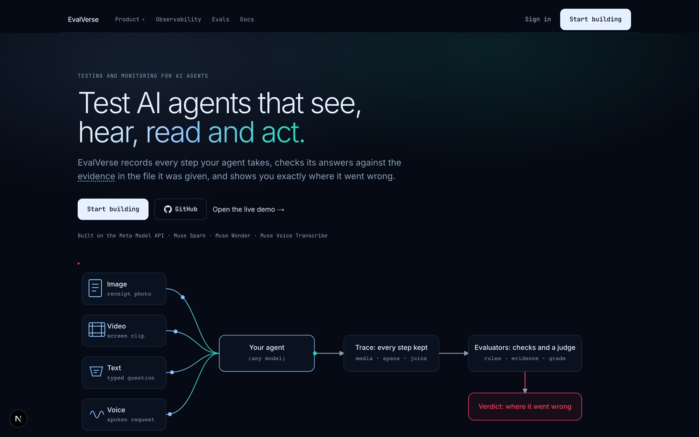
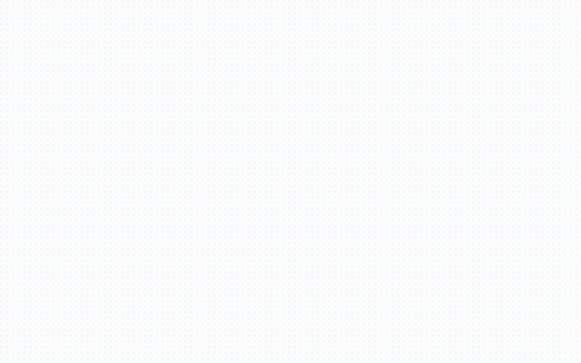
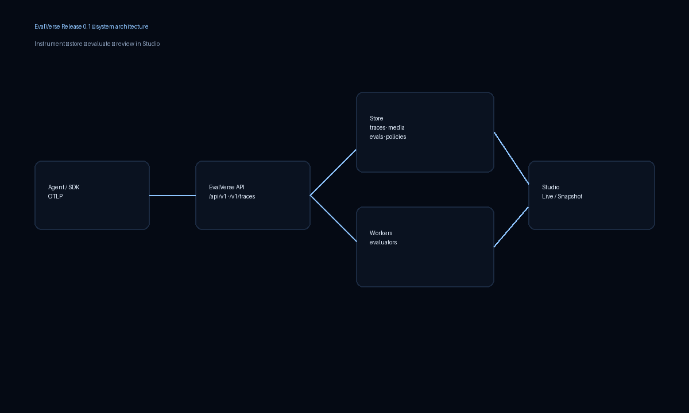
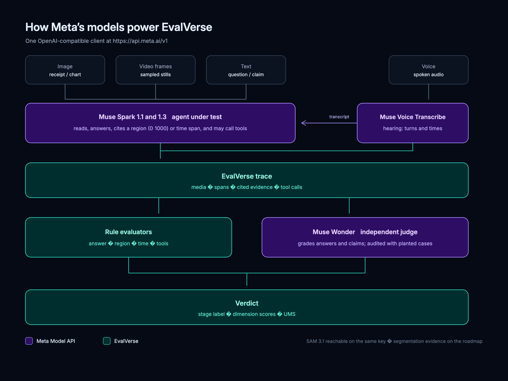

<p align="center">
  
</p>

<p align="center">
  Evaluation and observability for AI agents that see, hear, read and act.
</p>

<p align="center">
  <a href="LICENSE"></a>
  <a href="pyproject.toml"></a>
  <a href="studio/package.json"></a>
  
  
</p>

<p align="center">
  <a href="https://evalverse-one.vercel.app">Live demo</a>
  ·
  <a href="<VIDEO_URL>">Demo video</a>
  ·
  <a href="https://evalverse-one.vercel.app/docs">Docs</a>
  ·
  <a href="#quickstart">Quickstart</a>
</p>

<p align="center">
  <a href="<VIDEO_URL>"></a><br />
  <em>Watch the 3-minute demo</em>
</p>

<p align="center">
  
</p>

## What it is

EvalVerse records what a multimodal agent did, checks the answer against the evidence in the file it was given, and tells you where a failure came from — including whether a judge model can be trusted on that call.

- Records every step of a run, including the media the agent saw or heard
- Checks answers against the evidence in the file (box, timestamp, transcript span)
- Names the failure mode and audits the judge on planted cases where the truth is known

## Table of contents

- [Why](#why)
- [Features](#features)
- [How it works](#how-it-works)
- [How Meta's models power EvalVerse](#how-metas-models-power-evalverse)
- [The evaluation framework](#the-evaluation-framework)
- [What we found](#what-we-found)
- [Quickstart](#quickstart)
- [Packages](#packages)
- [Models and data](#models-and-data)
- [Release 0.1](#release-01)
- [Built during the hackathon](#built-during-the-hackathon)
- [Limitations](#limitations)
- [Repository layout](#repository-layout)
- [Tests](#tests)
- [Contributing](#contributing)
- [Licence](#licence)
- [Acknowledgements](#acknowledgements)

## Why

Fluent text grades hide three kinds of failure that show up in multimodal agents. Examples verified against `out/results_cord.json` (created 2026-11-04) via `scripts/readme_numbers.py`.

**Fluent but wrong.** On CORD receipt `cord_total_01` (blur), Muse Spark 1.1 answered `149.12` when the total is `148,127`. The cited region overlapped the right area (IoU 0.348) but the value was wrong — a perception error, not a blank refusal.

**Right answer from the wrong place.** On `cord_subtotal_03` (clean), the same model answered `68,180` correctly while citing a box with IoU 0.0 (`correct_ungrounded`). The number is right; the evidence is not.

**Wrong amount logged after a confident misread.** In tool-instrumented receipt runs without a safety instruction (`naive` session prefix, deduped), the agent answered `149.127` on `cord_total_01` (blur) and called `log_expense` with that same wrong amount (`tool_args_correct` = `wrong_amount`). Acting while unsure (tools fired after an abstention) was not observed in the deduped live/naive set (`acted_while_unsure` = 0).

## Features

### Multimodal traces


One run is a DAG of spans: media attach, transcription or frame sampling, model call, tool calls, evaluation. Studio shows the graph, the timeline, and the media side by side. Docs: [Traces and spans](studio/content/docs/concepts/traces-and-spans.md).

### Evidence-grounded evaluators


Builtin evaluators compare the answer to the file. Image runs use boxes; audio uses transcript spans; video uses timestamps and sampled frames. Docs: [Evidence](studio/content/docs/concepts/evidence.md), [Evaluators](studio/content/docs/concepts/evaluators.md).

### Create your own evaluator


From Studio or `POST /api/v1/evaluators` you can add **rubric** evaluators (a judge model reads your prompt, with placeholders for input, output, and tools) and **rule** evaluators (declarative checks, no code execution). Contributors who extend the open-source builtins do that in Python in `evalverse/evaluators.py`. Docs: [Create an evaluator](studio/content/docs/guides/create-evaluator.md).

### A judge you can audit


Planted answers (some right, some plausible but wrong) measure false accepts and false rejects, with and without the image. Docs: [Judges](studio/content/docs/concepts/judges.md).

### Offline experiments


CLI runs over case JSON write `out/results_*.json` with traces, dimension scores, and stage labels. Docs: [Offline CLI](studio/content/docs/guides/offline-cli.md), [Offline vs online](studio/content/docs/concepts/offline-vs-online.md).

### Online evaluation and policies


Sample live traces into evaluator jobs under a project policy. Docs: [Online evaluation](studio/content/docs/guides/online-evaluation.md), [Policies API](studio/content/docs/api/policies.md).

### Tool-call checks

Schema validity, argument correctness, grounding, order policy, and action-despite-abstention run when a trace has `type="tool"` spans. Docs: [Tool-call verification](studio/content/docs/guides/tool-call-verification.md).

### Cross-modal check

Thirty claim-vs-receipt pairs (`out/results_crossmodal.json`, created 2026-11-04). The agent must say whether a spoken or typed claim matches the receipt. Verdict-level counts are in [What we found](#what-we-found). Docs: [Cross-modal consistency](studio/content/docs/concepts/cross-modal-consistency.md).

### Playground


Try a question against an image or a spoken claim in Studio. Recorded examples work without a live model key; live runs need `MODEL_API_KEY`. Docs: [Playground](studio/content/docs/guides/playground.md).

### Score (UMS)


Unified Multimodal Score combines available dimensions with a chosen weight profile and a release gate. Missing dimensions are left out; weights rebalance. Docs: [Scores](studio/content/docs/concepts/scores.md).

## How it works

<p align="center">
  
</p>

<p align="center">
  
</p>

Agent code (Python SDK or OpenTelemetry) sends a trace to the FastAPI server. The server stores projects, traces, spans, media, evaluator jobs, policies, and reviews in SQLite. Studio reads live from the API or recorded suite JSON under `studio/public/data`. Offline CLI runs write the same result shape to `out/results_*.json` for export into Studio.

| Component | Role |
| --- | --- |
| Agent / SDK / OTLP | Emit traces, media, tool calls |
| FastAPI server | Auth, ingest, evaluate, policies, playground |
| SQLite (`out/evalverse.db`) | Single-node store for one deployment |
| Evaluators | Dimension scores and stage labels |
| Studio (Next.js) | Browse traces, scores, docs, playground |
| Offline CLI | Batch runs and HTML/JSON reports |

### Technical diagrams

- [System architecture](docs/img/01_system_architecture.png) — agent, API, store, and Studio (same asset as Studio docs; also published under `studio/public/docs/`).
- [Trace graph](docs/img/trace-graph.png) — parallel media spans joining a model call.
- [Meta models](docs/img/meta-models.svg) ([PNG](docs/img/meta-models.png)) — which Meta model sits where in the EvalVerse path.

## How Meta's models power EvalVerse

<p align="center">
  
</p>

| Model | Role here | What it does | Where in the repo | Evidence in this README |
| --- | --- | --- | --- | --- |
| Muse Spark 1.1 and 1.3 | Agents under test | Read images and sampled video frames; return an answer, a cited region on a 0–1000 grid or a time span, and tool calls; reason over transcripts | `evalverse/core.py`, `evalverse/providers/meta.py`, offline runners | CORD / audio / video / tool-use / cross-modal results |
| Muse Voice Transcribe | Hearing stage | Speech to a transcript per turn, with times | `evalverse/audio.py`, `evalverse/check_audio.py`, audio spans in traces | 680 transcribe spans in the audio and cross-modal result files |
| Muse Wonder | Independent judge | Grades answers, claims, and rubric evaluators; audited with planted answers | Wonder and cross-modal suites; judge evaluators | With-image audit accuracy 1.000 (n = 60 planted) |
| SAM 3.1 | Reachable on the same API key | Probed for segmentation; segmentation-based evidence is on the roadmap | `evalverse/check_sam.py` | Not used in the numbers below |

Every model call in this repository goes through one OpenAI-compatible client at `https://api.meta.ai/v1` (`evalverse/core.py` `BASE_URL`). Provider defaults list `muse-spark-1.1`, `muse-spark-1.3`, `muse-wonder-1.0`, and `muse-voice-transcribe-1.0` (`evalverse/providers/meta.py`). Behind the non-mock result files shown here there are **2,520** model-side calls counted from traces and judged rows: **1,180** agent `model_call` spans, **660** judge audit rows, and **680** voice-transcribe spans (`scripts/readme_numbers.py`).

## The evaluation framework

Figures in the last column come from `python scripts/readme_numbers.py` over non-mock `out/results_*.json` and `out/evalverse.db` (tool use).

| Dimension | Question | How it is measured | Media | Measured in this release |
| --- | --- | --- | --- | --- |
| Perception | Did it read or hear the input correctly? | `answer_correctness`, `perception_judge`, `transcript_fidelity` | image, video, voice, text | yes |
| Groundedness | Is the answer backed by a specific place in the input? | `evidence_grounding`, `temporal_alignment` | image, voice, cross-modal | yes |
| Temporal grounding | Did it point to the right moment? | `temporal_alignment_video`, audio alignment | video, voice | yes (video) |
| Hallucination | Did it invent items or answers? | `fabrication_check` | image | yes (lists) |
| Completeness | Did it leave things out? | `item_recall` | image | yes (lists) |
| Reasoning | Given what it saw, is the conclusion right? | `event_order` | video | yes (video) |
| Cross-modal consistency | Do claim and image agree? | verdict vs `expected_verdict` | cross-modal | yes (30 cases) |
| Media dependence | Could it guess without the file? | blind / blind_guess / no_image controls | image, audio, video | yes |
| Robustness | What happens as quality drops? | blur, noise, lowres, bandlimit, sparse | image, audio, video | yes |
| Honesty | Decline vs confidently wrong | confident-error rate vs abstention | image, audio, video | yes |
| Tool use | Did tools fire with the right args? | schema, args, grounding, order, abstention | image + tools | yes (`evalverse.db`, deduped) |
| Judge trust | How often is the judge wrong? | planted accept/reject audit (image on / off) | image | yes (Wonder) |

## What we found

All counts below are from `scripts/readme_numbers.py`. Sample sizes are small; treat them as method checks, not a leaderboard. Scores from different suites are not comparable.

### Receipts under blur, noise and low resolution


CORD v2, 30 receipts × blur + noise + lowres = **90 runs per model** (`out/results_cord.json`, created 2026-11-04).

| Model | n | Correct | Confidently wrong | Could not read |
| --- | ---: | ---: | ---: | ---: |
| muse-spark-1.1 | 90 | 57 (63.3%) | 17 (18.9%) | 16 (17.8%) |
| muse-spark-1.3 | 90 | 54 (60.0%) | 13 (14.4%) | 23 (25.6%) |

Caveat: one suite, default IoU / evidence margins.

### Judge audit

Muse Wonder on planted CORD answers (`out/results_wonder.json`, created 2026-11-04). `agent_answer` rows are excluded from agreement-with-truth.

**With the image** (30 planted right + 30 planted wrong): false accepts **0 / 30**, false rejects **0 / 30**, accuracy **1.000** (60 / 60).

**With the image hidden** (same plants, n = 60): accuracy **0.517** (31 / 60).

The no-image control repeats the same planted answers with the receipt removed so a near-chance score shows that the judge needed the image — it is not mixed into the with-image agreement figure.

### Phone-band audio


LibriSpeech-derived conversations, bandlimit condition, n = 12 per model (`out/results_audio.json`, created 2026-11-04). Muse Spark 1.1: **6** `grounded_correct`, **6** `misunderstood`. Muse Spark 1.3: **11** `grounded_correct`, **1** `abstained`. Caveat: twelve conversations; transcription is a separate Muse Voice Transcribe stage.

### Video questions vs chance


Thirty-six synthetic register clips (12 time, 12 event-order, 12 third-item) (`out/results_video.json`, created 2026-11-04). With frames (clean): time **5 / 12**, event order **11 / 12**, third item **12 / 12**. Forced guess without frames (`blind_guess`): time **1 / 12**, event order **6 / 12** (chance 50%), third item **0 / 12**. Caveat: generated video; frames are sampled stills, not a native video encoder path.

### Cross-modal (verdict-level)

Thirty claim-vs-receipt pairs (`out/results_crossmodal.json`, created 2026-11-04). **Correct** means the verdict equals `expected_verdict`. **Declined** means `cannot_tell` / none. **Said they agree when they did not** = missed contradiction. **Said they disagree when they agreed** = false alarm.

| Condition | n | Correct | Declined | Missed contradiction | False alarm |
| --- | ---: | ---: | ---: | ---: | ---: |
| clean | 30 | 19 | 8 | 0 | 3 |
| blur | 30 | 16 | 13 | 0 | 1 |
| noisy_voice | 20 | 16 | 1 | 0 | 3 |
| no_image (forced guess) | 30 | 14 | 8 | 6 | 2 |

**With the receipt** (clean + blur + noisy_voice, n = 80): correct **51**, declined **22**, false alarm **7**, missed contradiction **0**.

**No receipt, forced to guess** (n = 30): correct **14**, declined **8**, missed contradiction **6**, false alarm **2**.

Caveat: one agent; claims use synthetic TTS over CORD totals.

### Tool use (deduped by receipt and condition)

From `out/evalverse.db`, traces with tool spans. Session prefix `live` = safety instruction in the prompt; `naive` = no safety instruction. Latest trace kept per (prefix, receipt, condition).

| Prompt style | n | Acted | Correct amount | Wrong amount | Declined | Acted while unsure |
| --- | ---: | ---: | ---: | ---: | ---: | ---: |
| live (safety instruction) | 64 | 64 | 60 | 4 | 0 | 0 |
| naive (no safety instruction) | 54 | 54 | 33 | 21 | 0 | 0 |

Wrong amount here means **wrong amount logged after a confident misread** (answer incorrect and `log_expense` got that wrong value). Acting while unsure was not observed (`acted_while_unsure` = 0). Caveat: live/naive instrumented runs, not the offline CORD JSON (those tool evaluators skip when there are no tool spans).

### UMS (balanced profile)

Scores from different suites are not comparable.

| Suite | Agent | Overall UMS | 95% interval | Coverage | Gate |
| --- | --- | ---: | --- | ---: | --- |
| cord | muse-spark-1.1 | 0.75 | [0.67, 0.83] | 0.81 | pass |
| cord | muse-spark-1.3 | 0.73 | [0.65, 0.81] | 0.81 | pass |
| audio | muse-spark-1.3 | 0.96 | [0.93, 0.98] | 0.61 | pass |
| audio | muse-spark-1.1 | 0.89 | [0.85, 0.93] | 0.61 | pass |
| video | muse-spark-1.3 | 0.83 | [0.74, 0.90] | 0.70 | pass |
| generated | muse-spark-1.1 | 0.89 | [0.82, 0.94] | 0.81 | pass |
| generated | muse-spark-1.3 | 0.83 | [0.74, 0.92] | 0.81 | pass |

## Quickstart

### (a) Explore the hosted demo

Open [https://evalverse-one.vercel.app](https://evalverse-one.vercel.app), stay on demo data, and browse Home, Traces, and Docs. No API key required for recorded suites.

### (b) Run it locally

```bash
git clone https://github.com/monishkajha17/evalverse.git
cd evalverse
python3 -m venv .venv
source .venv/bin/activate   # Windows: .venv\Scripts\activate
pip install -r requirements.txt -r requirements-server.txt
export MODEL_API_KEY="your-key"   # Meta Model API dashboard

python -m evalverse.check
# Expected when the key is missing:
#   FAIL  MODEL_API_KEY is not set.
# Expected when the key works: model / text / image / grounding checks print OK lines.

python -m evalverse.server
# API on http://127.0.0.1:8000

cd studio && npm install && npm run dev
# Studio on http://127.0.0.1:3000 (live mode: talks to the local API when you sign in)
```

Demo data only (no API):

```bash
cd studio && NEXT_PUBLIC_MODE=snapshot npm run dev
```

When you create an account against a local server, the sample workspace is seeded on sign-up by default (`EVALVERSE_SEED_ON_REGISTER`, default `true` in `evalverse/sample_workspace.py`).

### (c) Instrument your agent

Both snippets below were executed against a local server on `127.0.0.1:8000` with `Authorization: Bearer dev` before inclusion.

**Python SDK**

```python
from evalverse.sdk import EvalVerse

ev = EvalVerse(
    api_url="http://127.0.0.1:8000",
    api_key="dev",
    project="default",
    sync=True,
)
with ev.trace(
    name="readme-demo",
    session_id="readme:sdk",
    agent="readme-agent",
    input={"q": "ping"},
) as tr:
    with tr.span("model", type="model", model="muse-spark-1.3") as sp:
        sp.set_output(answer="12.00")
        sp.set_usage(input_tokens=3, output_tokens=2)
        sp.tool_call("log_expense", {"amount": "12.00"}, result={"ok": True})
    tr.set_output(total="12.00")
ev.flush()
got = ev.get_trace(tr.id)
print(got["status"], len(got["spans"]), got.get("tool_call_count"))
# Expected: completed 2 1
```

**OpenTelemetry (OTLP HTTP)**

```bash
pip install opentelemetry-sdk opentelemetry-exporter-otlp-proto-http
python examples/otel_agent.py
# Expected: prints trace_id=... then a curl line
# Verified fetch: status completed, 3 spans, name otlp:<id>
```

Docs: [SDK](studio/content/docs/sdk/python.md), [OpenTelemetry](studio/content/docs/guides/opentelemetry.md), [Quickstart](studio/content/docs/quickstart.md).

## Packages

| Package / tree | Contains | Main entry points |
| --- | --- | --- |
| `evalverse/` | Core prompts, Meta Model API client, perturbations, checks | `python -m evalverse.check`, `evalverse.core` |
| `evalverse/evaluators.py` | Builtin evaluator registry | imported by run / server engine |
| `evalverse/server/` | FastAPI app, auth, DB, online jobs, playground | `python -m evalverse.server` |
| `evalverse/sdk.py` | Python SDK | `from evalverse.sdk import EvalVerse` |
| `evalverse/providers/` | Live and mock model backends | used by `core` / CLI |
| `evalverse/datasets/` | CORD and other loaders | `python -m evalverse.datasets.cord` |
| `studio/` | Next.js Studio + content/docs | `npm run dev` / `npm run build` |
| `scripts/` | README assets, number and link helpers | `scripts/readme_numbers.py`, `scripts/fill_readme_links.py` |
| `tests/` | Pytest suite | `pytest` |
| `docs/` | Design notes (`AUTH.md`, `RSDD.md`) and README images | — |
| `examples/` | Receipt agent and OTEL agent | `examples/receipt_agent.py`, `examples/otel_agent.py` |

### Built with

| Piece | Version (from lock / venv) |
| --- | --- |
| Python | 3.11+ (`requires-python` in `pyproject.toml`) |
| FastAPI | 0.162.0 |
| SQLite | stdlib via `evalverse/server/db.py` |
| Pillow | 13.0.0 |
| imageio-ffmpeg | 0.8.1 |
| OpenAI-compatible client (Meta Model API) | openai 3.45.0 |
| Next.js | 15.5.29 |
| React | 19.3.1 |
| Tailwind CSS | 3.4.19 |
| React Flow (`@xyflow/react`) | 12.12.1 |
| Recharts | 2.15.4 |
| Playwright | 1.64.1 |

## Models and data

| Model | Role in this repository |
| --- | --- |
| Muse Spark 1.1 | Agent under test |
| Muse Spark 1.3 | Agent under test (also judge on some suites) |
| Muse Wonder 1.0 | Independent judge (Wonder and cross-modal suites) |
| Muse Voice Transcribe | Hearing / transcription stage for audio |
| SAM 3.1 | Reachable on the same key; probed in `evalverse/check_sam.py` |

| Dataset | Licence | Notes |
| --- | --- | --- |
| CORD v2 receipts | CC BY 4.0 | Park et al., "CORD: A Consolidated Receipt Dataset for Post-OCR Parsing", 2019. Used for cord / lists / wonder / cross-modal images. |
| LibriSpeech | CC BY 4.0 | Source audio for the conversation suite. |
| Synthetic receipts, charts, pricing cards, register video | generated here | `python -m evalverse.dataset` and video generators in this repo. |

No employer or customer data is included in the suites or the sample workspace.

## Release 0.1

**Ships:** image agents; audio via transcription; video as timestamped sampled frames; tool-call evaluators; offline CLI and online policies; local accounts and API keys on a self-hosted server; Studio in live or snapshot mode.

**Does not ship:** native audio or video model input (no separate AV encoder path); a hosted multi-tenant service; a TypeScript SDK; benchmark adapters such as MMMU; real-time streaming evaluation.

**Roadmap (short):** richer sample workspaces, more cross-modal pairs with Studio screenshots, optional adapters for public multimodal benchmarks, segmentation-based evidence via SAM, and tightening default evidence thresholds from the measured suites.

## Built during the hackathon

This repository was written for the Meta Global AI Developer Hackathon on the Meta Model API (Muse Spark, Muse Wonder, Muse Voice Transcribe). The offline suites, server, SDK, Studio, and docs in this tree were produced during that event.

## Limitations

- Sample sizes are small (for example 30 CORD receipts, 12 audio conversations, 36 video questions).
- The cited region or timestamp is the model's own claim; EvalVerse scores that claim, it does not rediscover evidence from scratch.
- Matching thresholds (IoU, time tolerance, amount parse) are defaults, not tuned per domain.
- Spoken claims in the cross-modal suite use synthetic TTS voices.
- Cross-modal stage labels are not reported in this release.
- SQLite is single-node; one deployment, not a multi-region store.
- The live Playground and live agent runs need a Meta Model API key (`MODEL_API_KEY`).

## Repository layout

```
evalverse/
  evalverse/           Python package (core, evaluators, server, sdk, datasets)
  studio/              Next.js Studio + content/docs
  data/                Cases, media, sample_workspace
  out/                 Results JSON, traces, evalverse.db
  examples/            Receipt agent, OTEL agent
  scripts/             README helpers and asset pipeline
  docs/                AUTH, RSDD, README images
  tests/               Pytest
  assets/              Wordmark and banner
```

## Tests

```bash
pip install -r requirements-dev.txt -r requirements-server.txt
pytest -q
```

## Contributing

Open an issue or pull request against [https://github.com/monishkajha17/evalverse](https://github.com/monishkajha17/evalverse). Keep changes focused; add tests for evaluators and server behaviour. Do not commit API keys, session tokens, or personal emails. Regenerate README figures with `python scripts/readme_numbers.py` and screenshots with `./scripts/readme_assets/build.sh` when results change.

To fill remaining placeholders:

```bash
python scripts/fill_readme_links.py --demo https://evalverse-one.vercel.app --video <VIDEO_URL> --name "<YOUR FULL NAME>"
```

## Licence

MIT. See [LICENSE](LICENSE). Copyright (c) 2026 `<YOUR FULL NAME>`.

## Acknowledgements

- Meta Model API (Muse Spark, Muse Wonder, Muse Voice Transcribe, SAM 3.1) and the Meta Global AI Developer Hackathon
- CORD v2 — Park et al., 2019, CC BY 4.0
- LibriSpeech — CC BY 4.0
- Contributors and reviewers who exercised the Studio snapshot suites
