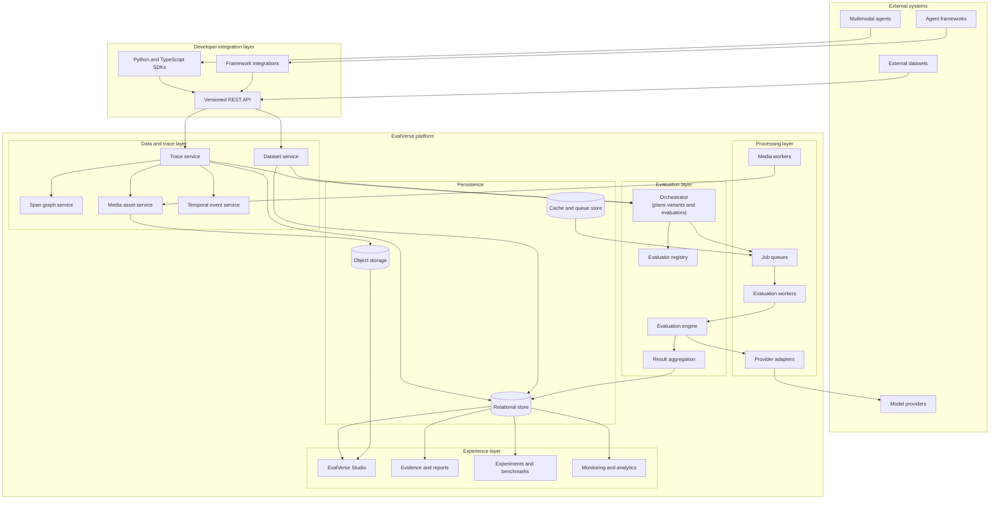
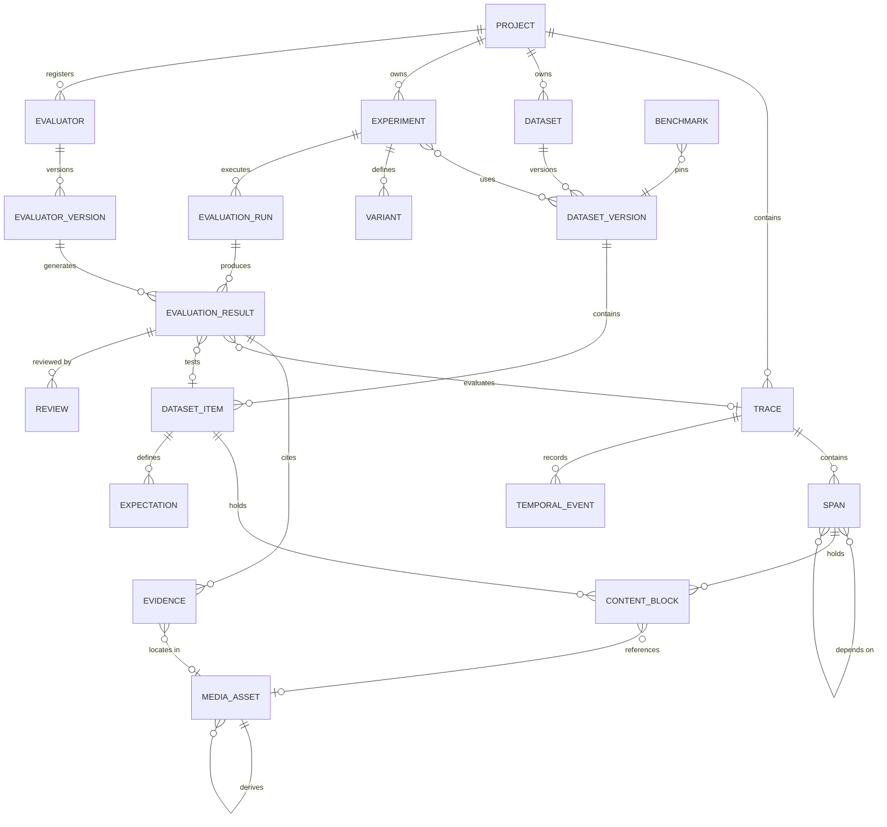
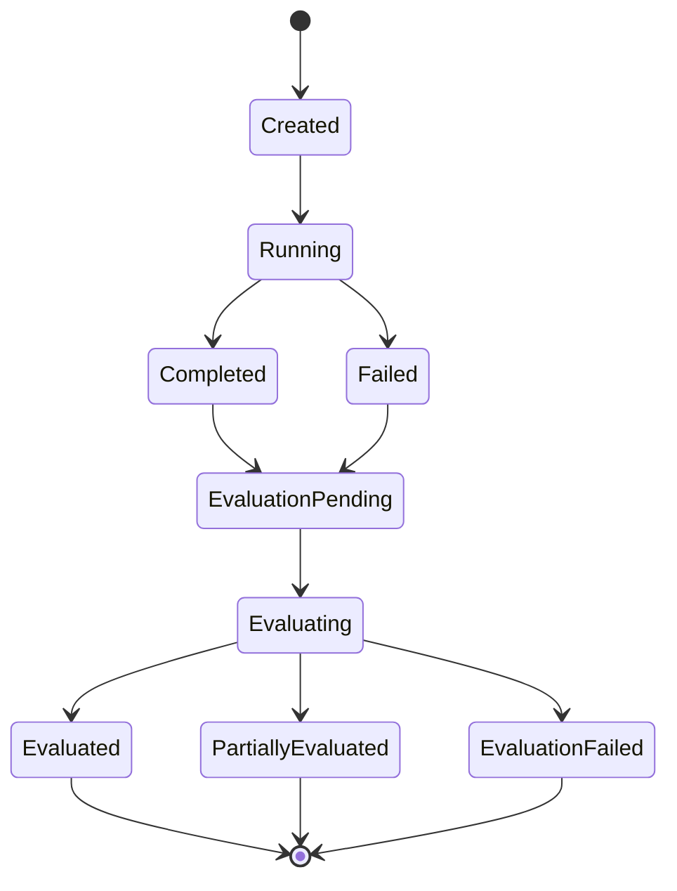
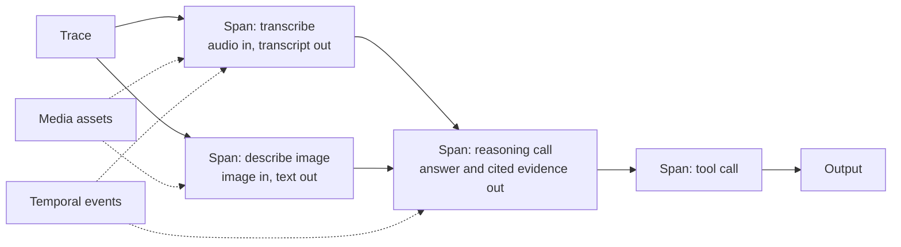
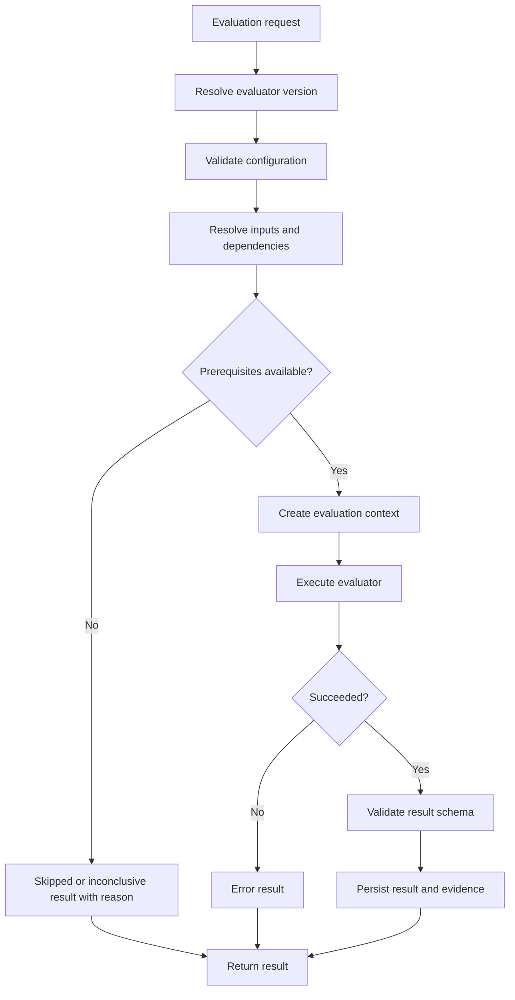
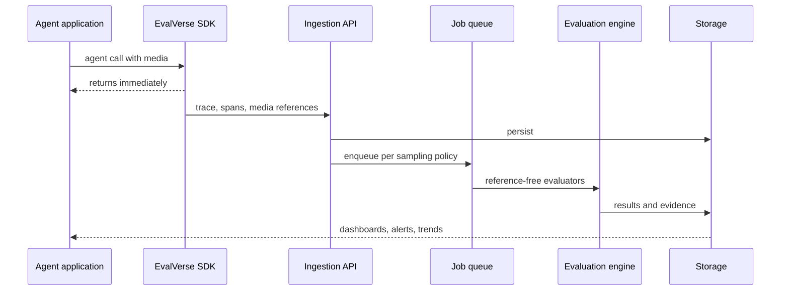
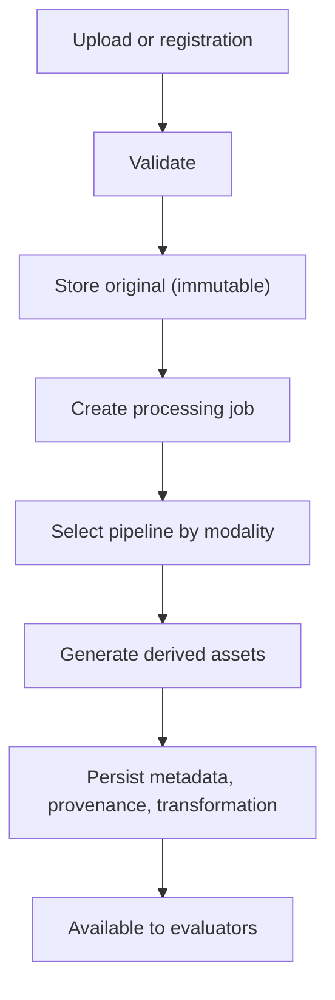

# EvalVerse: Requirements and System Design Document (RSDD)

**Where Multimodal AI Meets Measurable Intelligence.**

**Version:** 2.0 · **Date:** 4 Nov 2026
**Parent document:** EvalVerse Product Requirements Document
**Architecture approach:** modular, provider-agnostic, multimodal-first, evidence-first
**Audience:** engineers, AI researchers, platform engineers, contributors, technical reviewers

---

## 1. Purpose

This document translates the EvalVerse PRD into a technical specification: components, domain model, interfaces, evaluator framework, execution flows, storage, and operations. It describes the complete target system. Section 24 defines **Release 0.1**, the first implementation slice (image and audio).

| Document | Responsibility |
|---|---|
| Product Requirements Document | Product vision and functional capabilities |
| **RSDD (this document)** | Target architecture and technical requirements |
| Implementation plan | Order of delivery |
| API and SDK specifications | Detailed request, response and error contracts |
| Test strategy | Validation, reliability and acceptance testing |

---

## 2. Design principles

| Principle | Meaning in the design |
|---|---|
| **Multimodal-first** | The core model never assumes text. Media is stored, hashed and referenced, not flattened into descriptions. |
| **Evidence-first** | Every finding points to a region, time span or trace step. Evidence is an object with a role, not a sentence. |
| **Trace-native** | Evaluation attaches to the execution record, so a verdict can be followed back to the step that caused it. |
| **Dimensions stay separate** | Evaluators return their own results. Aggregation is an explicit policy. Nothing is silently averaged. |
| **Missing is not zero** | Skipped, errored and inconclusive evaluations are distinct statuses and never become a score. |
| **Trust is measured** | Judges and graders are evaluated (planted answers, human agreement, repeat consistency) before their verdicts are relied on. |
| **Observable behavior only** | Evaluators judge inputs, outputs, tool calls and cited evidence, never hidden reasoning. |
| **Evaluators are side-effect free** | An evaluator reads context and returns a result. Anything that must re-run an agent is expressed as a *variant* planned by the orchestrator (section 10). |
| **Provider-agnostic** | No provider is a hard dependency. Agent models and evaluator models are separate roles. |
| **Ports and adapters** | The domain core imports no database, queue, provider or web framework. Each sits behind an interface. |
| **Reproducible by default** | Every run stores a manifest of dataset, evaluator, model, variant and seed versions. |
| **Asynchronous by design** | Expensive evaluation and media processing never block the agent. |

---

## 3. System overview

EvalVerse has five layers:

1. Developer integration (SDKs, REST API, framework integrations)
2. Multimodal data and trace
3. Evaluation and orchestration
4. Model provider and media processing
5. Experience and analytics (Studio, reports, experiments, monitoring)



**Deployment model.** A modular monolith with separate background workers. These boundaries stay explicit so each can be split later without changing the domain model: API and application services, domain core, evaluation engine, evaluators, provider adapters, media processing, persistence adapters, background jobs, frontend.

---

## 4. Components

| Component | Responsibility |
|---|---|
| **SDKs** | Thin clients: authentication, trace and span lifecycle, content serialization, media upload, batching, retries, evaluation submission. No evaluation logic. |
| **API layer** | Authentication, validation, project resolution, rate limiting, versioning, error handling. Delegates to application services; implements no evaluator logic. |
| **Trace service** | Creates, updates and retrieves traces; links spans and media; triggers evaluation per policy. |
| **Span graph service** | Spans, multi-parent dependencies, status, timing, graph validation (acyclic), graph retrieval. |
| **Media asset service** | Registers and stores original assets, content-addresses them, tracks derived assets and their transformations, enforces retention. |
| **Temporal event service** | Timestamped events from several sources, queryable by time range on a declared time base. |
| **Dataset service** | Datasets, immutable versions, items, expectations, splits, import and export. |
| **Orchestrator** | Control plane: resolves targets, expands variants, selects evaluators, builds the execution plan, dispatches jobs, detects conflicts. Never fabricates scores. |
| **Evaluator registry** | Evaluators and versions with declared capabilities, modalities, reference requirements and dependencies. Built-in and plugin. |
| **Evaluation engine** | Runs one evaluator in a controlled runtime: context, config validation, timeouts, retries, result validation, execution metadata. |
| **Provider adapters** | Uniform interface to model providers in both agent and evaluator roles. |
| **Media workers** | Format conversion, segmentation, transcription, frame extraction, perturbation, derived assets. |
| **Aggregation** | Applies the configured policy to produce per-dimension summaries, optional composites, and disagreement reports. |
| **Studio** | Trace explorer, evidence viewers, reports, experiments, configuration. Reads the same contracts the API serves and holds no evaluation logic. |

---

## 5. Domain model



### 5.1 Entities

| Entity | Key fields |
|---|---|
| **Project** | id, name, description, owner, settings, retention policy, timestamps |
| **Trace** | id, project, session, external id, name, status (`running`, `completed`, `failed`), agent version, metadata, started and ended times. Input and output are ContentBlocks with role `input` / `output`. |
| **Span** | id, trace, **`parent_span_ids` (list)**, name, type (`agent`, `model`, `tool`, `retrieval`, `media`, `evaluation`, `custom`), status (`pending`, `running`, `completed`, `failed`, `cancelled`), metadata, started and ended times, usage (tokens, cost), error |
| **ContentBlock** | id, **exactly one owner** (`trace_id`, `span_id` or `dataset_item_id`, enforced by a check constraint), `role` (`input`, `output`, `expected`), modality (`text`, `image`, `audio`, `video`, `structured`), sequence index, payload or media asset id, metadata, schema version |
| **MediaAsset** | id, project, storage key, MIME type, modality, size, checksum, duration, dimensions, sample rate, `parent_asset_id`, **`transformation`** (`{op, params, seed}`), role (`original`, `derived`), processing status, timestamps |
| **TemporalEvent** | id, trace, span, media asset, **`time_base`** (`media` = ms from media start, `trace` = ms from trace start), start and end, source (`asr`, `agent_citation`, `ground_truth`, `evaluator`), label, speaker, confidence, payload |
| **Dataset / DatasetVersion** | Dataset: name, description, metadata. Version: immutable once referenced by an experiment; content hash |
| **DatasetItem** | id, version, input ContentBlocks, tags (modality, family, difficulty), annotations, metadata |
| **Expectation** | id, item, kind (`answer`, `evidence`, `transcript`, `entity_set`, `event_sequence`, `rubric`, `schema`, `planted_answer`), value, tolerance, source |
| **Variant** | id, experiment, name, transform (`{op, params, seed}`): `identity`, `blur`, `noise`, `lowres`, `bandlimit`, `speed`, `remove_media`, `mask_evidence`. See section 10.4 |
| **Evaluator / EvaluatorVersion** | Evaluator: name, owner. Version: semantic version, category, dimensions, modalities, `needs_reference`, `needs_replay`, `depends_on`, `score_range`, `label_taxonomy`, config schema, output schema, implementation reference |
| **Experiment** | dataset versions, agent configurations, variants, evaluator versions, aggregation policy, execution parameters |
| **EvaluationRun** | id, project, experiment or trace, status (`pending`, `running`, `completed`, `failed`, `partial`), **manifest** (section 17.3), timestamps |
| **EvaluationResult** | id, run, evaluator version, target (trace or dataset item, plus agent configuration and variant), status, score, verdict, label, explanation, confidence, execution metadata |
| **Evidence** | id, result, type, media asset, span, locator, role, content, explanation |
| **Review** | id, result, reviewer, verdict, label, notes. Used for calibration and adjudication |
| **Benchmark** | id, name, pinned dataset version, evaluator versions, aggregation policy, methodology reference |

### 5.2 Modelling rules

- **One source of truth for content.** Span and trace input and output are ContentBlocks, not duplicated JSON.
- **Span graph is a DAG.** A span may have several parents (a join of two branches). The service rejects cycles.
- **Polymorphic ownership is constrained,** not left to convention.
- **Time bases are explicit.** An event timeline is meaningless without knowing whether `0` is the start of the media or of the trace.
- **Derived assets record how they were made,** so perturbed media can be regenerated exactly.

---

## 6. Canonical multimodal content model

An input or output is an ordered list of typed blocks, so mixed content needs no special cases.

```json
{
  "schema_version": "1.0",
  "content": [
    {"type": "text",  "sequence_index": 0, "text": "Which day did the customer agree to?"},
    {"type": "audio", "sequence_index": 1, "asset_id": "asset-456",
     "metadata": {"mime_type": "audio/wav", "duration_ms": 41000}},
    {"type": "image", "sequence_index": 2, "asset_id": "asset-123",
     "metadata": {"mime_type": "image/png", "width": 700, "height": 900}}
  ]
}
```

| Block | Carries |
|---|---|
| **Text** | Text, language, offsets, source |
| **Image** | Asset reference, MIME type, dimensions, derived crops, region annotations |
| **Audio** | Asset reference, duration, sample rate, channels, optional transcript, speaker and segment annotations |
| **Video** | Asset reference, duration, frame rate, resolution, audio track, extracted frames, temporal annotations |
| **Structured** | JSON, schema reference, validation metadata |

**Schema versioning.** The content model carries a version. Changes are backward-compatible where possible; migrations are explicit.

**Derived media** always references its source: image crops, audio segments, transcripts, extracted frames, thumbnails, and perturbed variants. This provenance is what makes evidence auditable.

---

## 7. Trace and execution architecture

### 7.1 Lifecycles

Trace completion and evaluation completion are separate concepts: a trace can be finished while its evaluation is still running.



### 7.2 Trace as a DAG

An agent run is a graph of spans: sequential steps, parallel branches, joins, and evaluation branches.



### 7.3 Trace anatomy

| Part | Contents |
|---|---|
| **Metadata** | Project, trace id, session, agent version, timestamps, status |
| **Modality blocks** | Ordered text, image, audio, video and structured content |
| **Payload tracking** | Hashed references to original and derived media |
| **Temporal streams** | Timestamped events per source and time base |
| **Execution log** | Model, version, prompt, tool calls, latency, tokens, cost, errors |
| **Evaluation blocks** | Results, explanations and evidence attached to the trace |
| **Relationships** | Multi-parent span edges |

### 7.4 Ingestion and integrity

Ingestion supports synchronous creation, asynchronous span submission, batching, partial updates, and idempotency by external id. A trace stays inspectable when some spans or media jobs fail. Event time and ingestion time are stored separately and never confused.

---

## 8. Evidence and grounding

### 8.1 Evidence types and conventions

| Type | Locator | Convention |
|---|---|---|
| **Image region** | `[x_min, y_min, x_max, y_max]` | Normalized 0-1000 grid, origin top-left, relative to the exact image the model received; values slightly outside the grid are clamped |
| **Image point** | `[x, y]` | Same grid |
| **Polygon / mask** | point list or mask asset | For segmentation-derived evidence |
| **Time span** | `start_ms`, `end_ms` | On a media asset, `time_base = media` |
| **Speaker segment** | time span plus speaker id | Turn-level from diarization |
| **Video frame / interval** | frame index or interval | Frame references derived from the source |
| **Text span** | character offsets | In a content block |
| **Structured field** | JSON pointer | Tool outputs |
| **Trace span** | span id | The step where a claim originated |

### 8.2 Evidence roles

Each evidence record has a role: `expected` (ground truth), `claimed` (what the agent cited), `supports` or `contradicts` (what an evaluator found). Grounding evaluation compares `claimed` against `expected`.

### 8.3 Matching rules (defaults, calibrated per project)

| Match | Default rule |
|---|---|
| **Region** | Accept when overlap with the expected region is at least 0.25, or the claimed region's center lies inside the expected region, and the claimed area is at most 6 times the expected area (so a box covering the whole image never passes) |
| **Time span** | Accept when the claimed span overlaps at least half of the expected turn, or its midpoint lies inside it, with a tolerance suited to the timestamp source (turn-level, not word-level) |

These defaults are starting points. They are checked against a small set of human-labeled grounding judgments and adjusted; changing them creates a new evaluator version.

### 8.4 Claim-level grounding

Closed-form questions have one answer and one region. Open-ended outputs (captions, descriptions, summaries) contain many claims, so groundedness, hallucination and completeness are evaluated per claim:

1. A claim extractor splits the output into atomic assertions.
2. For each claim, a perception evaluator inspects the media and returns `supported`, `contradicted` or `not_found`, with evidence.
3. **Groundedness** = supported claims divided by total claims. **Hallucination** = contradicted plus unsupported claims, listed individually. **Completeness** = recall of reference facts when an expectation lists them.
4. Every claim result links its evidence, so a reviewer sees exactly which sentence failed and where.

### 8.5 Evidence integrity

References identify the exact source asset and location, with checksums and derived-asset relationships preserved, so evidence stays auditable.

---

## 9. Evaluator architecture

### 9.1 Interface

```python
class Evaluator(Protocol):
    id: str
    version: str
    category: str                  # deterministic | perception | temporal | cross_modal | judge | paired | human | composite
    dimensions: list[str]          # taxonomy dimensions it reports on
    modalities: set[str]           # {"image"}, {"audio"}, {"image", "audio"}, ...
    needs_reference: bool          # True: requires an Expectation. False: can run on live traces
    needs_replay: bool             # True: consumes results from re-executed variants (section 10.4)
    depends_on: list[str]          # evaluators whose results it consumes
    score_range: tuple[float, float] | None
    label_taxonomy: list[str] | None

    def describe(self) -> dict: ...
    def validate_config(self, config: dict) -> None: ...
    async def evaluate(self, ctx: "EvaluationContext", config: dict) -> "EvaluationResult": ...
```

`needs_reference` separates offline from online use: reference-based evaluators run on datasets; reference-free evaluators can run on production traces. The interface is a contract, not a requirement that every evaluator call a model.

### 9.2 Evaluation context

```python
class EvaluationContext:
    trace: Trace | None
    spans: list[Span]
    input_content: list[ContentBlock]
    output_content: list[ContentBlock]
    media_assets: list[MediaAsset]
    expectations: list[Expectation]
    temporal_events: list[TemporalEvent]
    prior_results: list[EvaluationResult]          # dependencies, including sibling variants
    provider: ProviderClient
    metadata: dict
```

Evaluators must not assume every field is present. Missing prerequisites produce a `skipped` or `inconclusive` result with a reason, never an invented score.

### 9.3 Result contract

```json
{
  "evaluator_id": "evidence_grounding",
  "evaluator_version": "1.0.0",
  "status": "completed",
  "score": 1.0,
  "score_range": [0, 1],
  "verdict": "pass",
  "label": "grounded_correct",
  "explanation": "Cited region overlaps the expected region (overlap 0.62).",
  "confidence": null,
  "evidence": [
    {"type": "image_region", "role": "expected", "locator": [120, 578, 880, 636]},
    {"type": "image_region", "role": "claimed",  "locator": [130, 570, 870, 640]}
  ],
  "execution_metadata": {"model": null, "latency_ms": 3}
}
```

| Field | Rule |
|---|---|
| `status` | `completed`, `failed`, `skipped`, `error`, `inconclusive`. Only `completed` carries a score. |
| `score` / `score_range` | Optional. The evaluator declares the range; the platform never assumes 0-1. |
| `verdict` | `pass`, `fail` or `not_applicable`, derived from an evaluator-declared threshold. |
| `label` | Categorical outcome from the evaluator's declared taxonomy (section 11). |
| `evidence` | Zero or more evidence records with roles. |

Aggregation treats every status other than `completed` as missing, never as zero.

### 9.4 Execution pipeline



### 9.5 Registry and plugins

The registry supports built-in evaluators, project-level evaluators and external packages, with version registration, capability discovery, configuration validation and compatibility checks. External code runs in a restricted environment with resource limits and mediated provider access; it never receives platform credentials or unrestricted network access.

---

## 10. Orchestration, variants and aggregation

### 10.1 Orchestrator

For each target the orchestrator:

1. Resolves the trace or dataset item and the evaluation configuration.
2. **Expands variants** (section 10.4) into runs.
3. Selects evaluators whose modalities match and whose reference requirements are met.
4. Builds the dependency graph from `depends_on` and runs independent evaluators in parallel.
5. Dispatches jobs, tracks them, and collects results.
6. Marks skipped and errored evaluators explicitly and **flags conflicts**.
7. Applies the aggregation policy and persists the run.

The orchestrator is rule-based by default: predictable, reproducible and cheap. An **Orchestrator Judge**, a model-assisted planner for larger mixed-modality items, is optional. It selects only among registered evaluators within policy, and it never replaces a missing specialist result with a generated score.

### 10.2 Aggregation

Aggregation is a per-project policy applied after evaluation.

| Mode | Behavior |
|---|---|
| **Per-dimension (default)** | Scores and label counts by dimension, agent and variant |
| **Composite (optional)** | Weighted average, minimum, required-pass, threshold or custom function. Weights are declared and stored, and the underlying results remain linked. Scores are normalized from declared `score_range` before combining. |
| **Disagreement report** | Pairs of evaluators that disagree beyond a threshold on the same target (for example a judge accepts what the grounding check rejects), surfaced for review |

A composite never replaces the per-dimension view.

### 10.3 Evaluation request

```json
{
  "target": {"type": "experiment", "id": "exp-7"},
  "evaluators": [
    {"name": "evidence_grounding", "version": "1.0.0", "config": {}},
    {"name": "media_dependence",   "version": "1.0.0", "config": {}}
  ],
  "aggregation": {"strategy": "per_dimension"},
  "execution": {"mode": "async"}
}
```

Request types: single trace, dataset, batch of traces, experiment, online asynchronous, and re-evaluation with a new evaluator version.

### 10.4 Variants

Some of the most informative checks require running the same item more than once under a transformation. EvalVerse models these as **variants**, planned by the orchestrator rather than performed inside an evaluator:

| Variant | Transform | Used by |
|---|---|---|
| `identity` | none (baseline) | everything |
| `blur`, `noise`, `lowres` | image degradation, seeded | RobustnessSweep |
| `bandlimit`, `speed`, `noise` (audio) | telephone-band filter, tempo, additive noise | RobustnessSweep |
| `remove_media` | the media block is dropped | MediaDependence |
| `mask_evidence` | the cited region is masked (or the cited audio span silenced) | EvidenceAblation |

The orchestrator expands *item × agent configuration × variant* into runs and stores each result with its variant. **Paired evaluators** then consume the results of sibling variants through `prior_results`. This keeps evaluators free of side effects and makes every variant run an ordinary trace that can be inspected.

**Replay safety.** Variants re-execute the agent. Offline, the agent is a registered function. Online, variants run only when the agent is registered as replayable (side-effect free, or sandboxed); otherwise the paired evaluator returns `skipped` with a reason. Re-running a production agent that has side effects is never done implicitly.

---

## 11. Evaluator catalog

| Evaluator | Category | Dimensions | Modalities | Reference | Replay |
|---|---|---|---|---|---|
| **AnswerCorrectness** | Deterministic | Perception, Accuracy | image, audio, video | yes | no |
| **EvidenceGrounding** | Deterministic | Groundedness | image, audio, video | yes | no |
| **TemporalAlignment** | Temporal | Temporal grounding | audio, video | yes | no |
| **TranscriptFidelity** | Perception | Perception | audio | yes | no |
| **SpeakerAttribution** | Perception | Perception | audio, video | yes | no |
| **ClaimGrounding** | Perception (model-assisted) | Groundedness, Hallucination, Completeness | image, audio, video | optional | no |
| **FabricationCheck** | Deterministic | Hallucination | all | yes (inventory of what is present) | no |
| **UnanswerableProbe** | Deterministic | Hallucination | all | yes | no |
| **ItemRecall** | Deterministic | Completeness | all | yes | no |
| **MultiStepCheck** | Deterministic | Reasoning | all | yes | no |
| **PerceptionJudge** | Model judge | Perception, Hallucination | image | no | no |
| **TranscriptJudge** | Model judge | Accuracy, Reasoning | audio | no | no |
| **CrossModalConsistency** | Cross-modal | Cross-modal consistency | image+audio, audio+video | no | no |
| **MediaDependence** | Paired | Groundedness, Grounded generation | all | no | yes |
| **EvidenceAblation** | Paired | Groundedness (causal) | image, audio | yes | yes |
| **RobustnessSweep** | Paired | all | all | yes | yes |
| **JudgeAudit** | Paired | Trust in judges | all | yes (planted answers) | no |
| **StageAttribution** | Composite | Failure analysis | all | consumes upstream | no |
| **HumanReview** | Human | Calibration | all | n/a | no |

### 11.1 The signature evaluators

- **MediaDependence.** Compares the `identity` and `remove_media` variants of the same item. A correct answer that survives removal of the media is labeled `media_not_required`: the agent did not need to look. Random ground-truth values make a surviving correct answer a strong signal of guessing or leakage.
- **EvidenceGrounding.** A cited region or span is a consistency check: it shows where the agent *says* it looked, not that the region caused the answer.
- **EvidenceAblation.** The causal counterpart: mask the cited region (or silence the cited audio span) and rerun. A grounded agent should fail or change its answer; an agent that answers identically was not relying on that evidence.
- **RobustnessSweep.** Aggregates results across degradation variants into a curve per dimension, showing which failure appears first as quality drops.
- **JudgeAudit.** Judges are run on `planted_answer` expectations: the true answer and plausible wrong answers drawn from the same media. Reports false-accept rate and false-reject rate. Judge results in any run are reported beside this audit. A further control reruns the judge without the media to test whether it relies on it.

### 11.2 Applicability

Answer, region and span checks assume tasks with a verifiable answer. Open-ended generation is covered by ClaimGrounding and the judges, which carry their own reliability measurements. Both families run in the same framework and report in the same result contract.

---

## 12. Outcome labels and stage attribution

Each evaluated case receives exactly one outcome label.

| Label | Meaning | Likely fix |
|---|---|---|
| `grounded_correct` | Right answer, right place | none |
| `correct_ungrounded` | Right answer, wrong place | Possible guess or shortcut |
| `misread` | Wrong answer, right place (visual) | Perception or OCR quality |
| `misunderstood` | Wrong answer, right place, and the transcript contains the fact (audio) | Reasoning stage |
| `heard_wrong` | Wrong answer, and the transcript lacks or distorts the key fact (audio) | Speech recognition stage |
| `mislocated` | Wrong answer, wrong place | Grounding or retrieval |
| `invalid_output` | Output could not be parsed | Prompt or output format |

```
if output unparseable                                      -> invalid_output
if answer correct:
    if evidence matches                                    -> grounded_correct
    else                                                   -> correct_ungrounded
else:                                                      # answer wrong
    if pipeline has a hearing stage
       and ASR text over the true turn lacks the key fact  -> heard_wrong
    elif evidence matches:
        if pipeline has a hearing stage                    -> misunderstood
        else                                               -> misread
    else                                                   -> mislocated
```

`heard_wrong` applies only to wrong answers, since a correct answer despite a poor transcript is better described as `correct_ungrounded`. "Key fact present" means the normalized expected value (number, name, day) appears in the ASR segments overlapping the true turn.

---

## 13. Provider architecture

### 13.1 Roles

The **system under evaluation** (agent or model) and the **evaluator model** (judge, transcriber) are separate configured roles, reported separately. One model may fill both, and that is disclosed in the run manifest.

### 13.2 Capabilities

| Capability | Meaning |
|---|---|
| `text` | Text generation |
| `image_input`, `audio_input`, `video_input` | Native reasoning over that modality |
| `transcription` | Speech to text (distinct from `audio_input`), with optional diarization and timestamps |
| `grounding` | Returns coordinates for described objects |
| `segmentation` | Returns masks for prompts |
| `structured_output` | Schema-constrained output |
| `tool_calling` | Tool invocation |
| `embeddings` | Vector representations |

Speech-to-text models are not audio-reasoning models; the distinction is a first-class capability so a pipeline built on transcription is described as such.

### 13.3 Interface

```python
class ModelProvider(Protocol):
    name: str
    def capabilities(self, model: str) -> Capabilities: ...
    async def generate(self, model: str, content: list[ContentBlock], *,
                       schema: Schema | None = None, grounding: bool = False) -> ModelResponse: ...
    async def transcribe(self, model: str, audio: MediaAsset, *,
                         diarize: bool = True, language: str | None = None) -> Transcript: ...
    async def segment(self, model: str, image: MediaAsset, prompts: list[str]) -> list[Mask]: ...
    async def embed(self, model: str, content: list[ContentBlock]) -> list[Vector]: ...
```

Unsupported capabilities are declared, not stubbed. Every call records provider, model and version, request id, token usage, latency, cost, retry count and errors. Credentials never appear in traces, logs or results. Fallback providers are explicit and recorded; the system never switches models silently.

### 13.4 Meta Model API adapter

The adapter targets the OpenAI-compatible endpoint (`https://api.meta.ai/v1`) through the Responses or Chat Completions API. Images are sent as base64 data URLs or file references; grounding returns coordinates on the normalized 0-1000 grid; speech goes through Muse Voice Transcribe, which provides transcripts, speaker labels and turn-level timestamps. Muse Spark models serve as agents under evaluation and as judges; segmentation uses SAM through the same adapter interface.

---

## 14. Execution modes

### 14.1 Offline

1. Select a dataset version, agent configurations, variants and evaluators (an experiment).
2. The orchestrator expands runs; each run executes the agent and is stored as a trace.
3. Evaluators score each trace; paired evaluators consume sibling variants.
4. Aggregation produces per-dimension summaries, disagreements and comparisons.
5. Results open in Studio with the media and evidence.

### 14.2 Online



Production traffic has no ground truth, so online mode runs reference-free evaluators: model judges, ClaimGrounding, transcript cross-checks on cited spans, cross-modal consistency, and, for replayable agents only, MediaDependence and EvidenceAblation. Sampling, evaluator selection, cost and latency monitoring and failure alerts are project-level policy. A failure found online can be promoted into a dataset item, so the offline suite gains a regression case.

Offline and online evaluation use the same evaluator contracts and result model. Only the trigger and execution policy differ.

### 14.3 Jobs

Jobs carry unique ids and idempotency keys, with retry policies, timeouts, cancellation, status, and dead-letter handling. Retries never create duplicate results. A run may finish **partial** when some evaluators fail; it is never reported as fully successful, and all completed results are preserved.

---

## 15. Media processing



| Modality | Capabilities |
|---|---|
| **Image** | Metadata, format validation, resizing, thumbnails, crops, perturbation (blur, noise, low resolution, region masking) |
| **Audio** | Format conversion, duration and sample-rate normalization, segmentation, transcription, diarization, timestamp extraction, perturbation (noise, band-limiting, speed, span silencing) |
| **Video** | Metadata, frame extraction and sampling, scene segmentation, audio track extraction, synchronization, frame-level evidence references |

Originals are immutable; derived assets reference their source and record the transformation and seed. Failures are recoverable and observable; size and duration limits are configurable.

---

## 16. API and SDK

### 16.1 REST API (`/api/v1`)

| Group | Endpoints |
|---|---|
| **Projects** | `POST /projects`, `GET /projects`, `GET /projects/{id}` |
| **Traces** | `POST /traces`, `POST /traces/batch`, `GET /traces/{id}`, `PATCH /traces/{id}`, `GET /traces/{id}/graph` |
| **Spans** | `POST /traces/{id}/spans`, `GET /traces/{id}/spans`, `GET /spans/{id}`, `PATCH /spans/{id}` |
| **Media** | `POST /media`, `POST /media/{id}/complete`, `GET /media/{id}`, `GET /media/{id}/access` |
| **Datasets** | `POST /datasets`, `GET /datasets`, `POST /datasets/{id}/versions`, `POST /datasets/{id}/items`, `GET /datasets/{id}/items` |
| **Evaluators** | `POST /evaluators/register`, `GET /evaluators`, `GET /evaluators/{id}`, `GET /evaluators/{id}/versions` |
| **Evaluations** | `POST /evaluations`, `GET /evaluations/{id}`, `GET /evaluations/{id}/results`, `GET /evaluations/{id}/disagreements`, `POST /evaluations/{id}/cancel` |
| **Experiments** | `POST /experiments`, `GET /experiments`, `GET /experiments/{id}`, `GET /experiments/{id}/results`, `GET /experiments/{id}/comparison` |
| **Benchmarks** | `POST /benchmarks`, `GET /benchmarks`, `GET /benchmarks/{id}` |

**Conventions.** JSON; versioned; pagination on collections; `Idempotency-Key` on writes; long-running operations return `202` with a job id; OpenAPI documentation.

```json
{
  "error": {
    "code": "VALIDATION_ERROR",
    "message": "The submitted content is invalid.",
    "details": [{"field": "content", "reason": "Unsupported modality."}],
    "request_id": "request-123"
  }
}
```

**Authentication.** Project-scoped API keys initially, stored hashed and never returned after creation, with an extensible model for user sessions and role-based access.

### 16.2 Python SDK

```python
from evalverse import EvalVerse

ev = EvalVerse(api_key="...", project="receipt-agent")

with ev.trace(name="receipt-run", session="s-42") as tr:
    img = tr.media("receipt.png")                          # hashed and registered
    with tr.span("model_call", type="model", model="muse-spark-1.3") as sp:
        out = my_agent(img, "What is the total?")          # developer's own code
        sp.log_output(answer=out.answer,
                      evidence=ev.region(img, out.box))    # cited evidence as an object

ev.evaluate(trace=tr.id, evaluators=["evidence_grounding", "perception_judge"])
```

The SDK covers authentication, trace and span lifecycle, content serialization, media upload, batching, retries, evaluation submission and result retrieval. Tracing is non-blocking. A TypeScript SDK exposes the same domain capabilities and API contracts. Framework integrations capture execution without changing agent behavior.

---

## 17. Persistence and reproducibility

### 17.1 Stores

| Store | Holds |
|---|---|
| **Relational (PostgreSQL)** | Projects, traces, spans, content blocks, media metadata, temporal events, datasets and versions, items, expectations, evaluators and versions, runs, results, evidence, reviews, experiments, benchmarks. JSONB for flexible metadata, not as a substitute for relational modelling. |
| **Object storage (S3-compatible)** | Images, audio, video, large derived assets, attachments, exported reports |
| **Cache and queue store (Redis)** | Queue coordination, result caching, short-lived state, rate limiting. Never the authoritative store for results. |

Principles: metadata and binaries stay separate; originals are immutable; media access is authenticated and scoped; retention and deletion policies cover metadata and binaries together.

### 17.2 Caching

Model and judge results are cached by (evaluator version, input hash, configuration) so repeated runs do not repeat paid calls. Cache hits are recorded in execution metadata.

### 17.3 Run manifest

Stored with every evaluation run: dataset version and hash; evaluator versions; agent and judge models, versions and settings; variant definitions with seeds; provider data-sharing settings; code version. Reproducing or investigating a run requires nothing else.

---

## 18. Workers and queues

| Worker | Role |
|---|---|
| **Evaluation workers** | Execute evaluator jobs and persist results |
| **Media workers** | Process uploads, perturb media, create derived assets |
| **Dataset workers** | Import, export, validate, batch-prepare |
| **Experiment workers** | Expand variants, coordinate large runs, aggregate |

Requirements: configurable concurrency; retries and timeouts; idempotent jobs; structured logging; status tracking; graceful shutdown; failure recovery; cost and execution metadata. Separate logical queues for evaluation, media, dataset and experiment work keep large media jobs from starving evaluations.

---

## 19. EvalVerse Studio

| View | Content |
|---|---|
| **Project dashboard** | Traces, runs, quality by dimension, failure rates, modality mix, evaluator health, cost |
| **Trace explorer** | Search and filter; DAG view with zoom and pan; span detail with inputs, outputs, model and tool calls; status and duration |
| **Evidence viewers** | **Image:** the media with expected and claimed regions overlaid and the line between them. **Audio:** waveform and transcript with speaker lanes, expected versus cited span. **Video:** frame and interval viewer. All reached from any evaluator result. |
| **Evaluation detail** | Every evaluator's score, verdict, label, explanation, evidence, confidence and metadata; disagreements; aggregate |
| **Experiments** | Side-by-side agent versions, variant comparison, robustness curves, regression highlights, judge audit |
| **Datasets** | Items, expectations, tags, versions, annotations |
| **Evaluator catalogue** | Descriptions, modalities, configuration, versions, calibration results |
| **Review queue** | Cases where judges and deterministic checks disagree, for human adjudication |

---

## 20. Security, privacy and governance

| Area | Requirement |
|---|---|
| **Authentication** | API keys now; user and organization identity later |
| **Authorization** | Project-level access control on traces, media, datasets, evaluators, results, experiments |
| **Media** | Type and size validation; encrypted storage; scoped, expiring access URLs; no execution of uploaded content |
| **Secrets** | Provider keys in a secrets manager; excluded from traces, logs, evidence and exports |
| **Governance** | Retention policies; project and media deletion; access auditing; sensitive-data handling; provider data-sharing recorded per run |
| **Evaluator isolation** | Plugins run with restricted permissions, resource limits and mediated provider access |

---

## 21. Reliability, observability and testing

### 21.1 Reliability and scale

The system handles large uploads, high trace volume, concurrent evaluation, long-running inference, large batches, provider failures, partial evaluation failures, worker restarts and duplicate submissions. Mechanisms: asynchronous processing, idempotency, bounded retries, backpressure, queue isolation, pagination, object storage, indexing, configurable concurrency, persisted job state. Throughput and latency targets are set through load testing.

### 21.2 Platform observability

Metrics: API volume and errors, ingestion throughput, media throughput, queue depth, job duration, evaluator success and latency, provider error rate, storage use, evaluation cost. Every operation logs request, project, trace, span, run, evaluator and job ids; payloads and credentials are excluded. Internal tracing spans API, queue, worker, provider and persistence.

### 21.3 Testing

| Layer | Coverage |
|---|---|
| **Unit** | Domain objects, services, evaluators, matching rules |
| **Contract** | API schemas, SDK serialization, evaluator input and output contracts, provider adapters, content schemas |
| **Integration** | API with database, storage and queue; workers with registry; evaluators with provider adapters; trace service with orchestration |
| **Evaluator tests** | Positive, negative, edge, missing-input, invalid-config and evidence-validation cases per evaluator |
| **Calibration tests** | Matching thresholds checked against human-labeled grounding judgments; judge audit baselines; repeat-run consistency |
| **End to end** | Image, audio and mixed traces; offline dataset run with variants; asynchronous online run; inspection in Studio |
| **Reproducibility** | A run's manifest reproduces its result |
| **Security** | Authentication, cross-project access, media access, file validation, secrets leakage, evaluator isolation |

---

## 22. Repository structure and dependency rules

```text
evalverse/
├── apps/
│   ├── api/                  routes, dependencies, middleware
│   └── studio/               app, components, features, lib
├── packages/
│   ├── core/                 domain, schemas, contracts, exceptions
│   ├── evaluation-engine/    runtime, context, execution, aggregation, variants
│   ├── evaluator-registry/   registry, discovery, validation
│   ├── media/                storage, processing, perturbation
│   ├── providers/            base, meta, other-providers, mock
│   ├── sdk-python/
│   └── sdk-typescript/
├── evaluators/
│   ├── deterministic/        answer, grounding, fabrication, recall
│   ├── perception/           transcript fidelity, speaker, claim grounding
│   ├── temporal/
│   ├── cross-modal/
│   ├── judges/               perception judge, transcript judge
│   ├── paired/               media dependence, ablation, robustness, judge audit
│   ├── human/
│   └── composite/            stage attribution
├── workers/                  evaluation, media, dataset, experiment
├── research/                 benchmarks, datasets, experiments, findings
├── infra/                    docker, database, storage, deployment
├── tests/                    unit, integration, contract, evaluation, calibration, fixtures
├── docs/                     product, architecture, api, sdk, evaluators, contributing
└── README.md · CONTRIBUTING.md · LICENSE · pyproject.toml · package.json · docker-compose.yml
```

**Dependency rules.**
1. `core` depends on no API, database or provider implementation.
2. Evaluators depend on domain contracts, never on API routes or storage.
3. Provider adapters implement provider-neutral interfaces.
4. API routes delegate to application services.
5. Workers use the same application and domain contracts as synchronous paths.
6. SDKs communicate only through the public API and never import backend internals.
7. Media processing preserves provenance and records transformations.
8. All evaluators return the shared result contract.

---

## 23. Technology and trade-offs

| Layer | Direction |
|---|---|
| API | Python, FastAPI, Pydantic |
| Persistence | PostgreSQL with SQLAlchemy |
| Jobs | Redis-backed workers (queue technology validated in a spike) |
| Media storage | S3-compatible object storage |
| Media processing | FFmpeg and Pillow-based processors |
| Frontend | Next.js, TypeScript |
| SDK | Python first, then TypeScript |
| Local development | Docker Compose |

| Decision | Chosen | Alternative | Reason |
|---|---|---|---|
| Aggregation | Per-dimension by default | Single composite | A composite hides the disagreement that matters |
| Grounding | Deterministic region and span matching, plus causal ablation | Model-judged grounding only | Exact where truth exists, auditable, and testable for causation |
| Judge trust | Audit with planted answers | Trust by default | Judges are measured before being relied on |
| Re-execution | Variants planned by the orchestrator | Evaluators that call the agent | Keeps evaluators side-effect free and every variant inspectable |
| Orchestration | Rule-based, optional model planner | Model-only | Predictable, reproducible, cheaper |
| Test media | Generated with known truth | Scraped or hand-annotated | Exact ground truth, no licensing or labeling cost |
| Storage coupling | Ports and adapters | Direct calls | One core for a small deployment and a full platform |
| Span structure | Multi-parent DAG | Tree | Joins of parallel branches are normal in agents |

**Decisions to validate by spike:** queue and worker framework (and sync-versus-async evaluator execution within it); object storage and its local equivalent; large-media upload; trace batching and idempotency; evaluator plugin packaging and isolation; provider capability negotiation and fallback; dataset version immutability; score normalization semantics; trace graph query strategy; multi-tenant access model; retention policy; benchmark export formats.

**To revisit as the system grows:** relational versus graph-oriented storage for the span graph, the temporal event store at video scale, evaluator sandboxing, and judge-cost routing.

---

## 24. Release 0.1: implementation slice (image and audio)

EvalVerse is specified above as a complete platform. **Release 0.1** implements the same domain contracts with lighter infrastructure, so each part grows into the architecture rather than being replaced. It was built for the Meta Global AI Developer Hackathon.

### 24.1 Scope

| | Core | Extension |
|---|---|---|
| **Modality** | Image | Audio |
| **Test data** | 21 generated images (receipts, charts, pricing cards) with exact answers and regions | At least 12 generated multi-speaker conversations with exact turns and time spans |
| **Agents** | Muse Spark 1.3 and 1.1, answering with cited regions | The same models over transcripts from Muse Voice Transcribe |
| **Variants** | identity, blur, noise, lowres, remove_media | identity, noise, bandlimit, remove_media |
| **Evaluators** | AnswerCorrectness, EvidenceGrounding, MediaDependence, RobustnessSweep, JudgeAudit, StageAttribution | TranscriptFidelity, TemporalAlignment, SpeakerAttribution, StageAttribution (audio labels) |
| **Advanced** | | EvidenceAblation, UnanswerableProbe, ClaimGrounding prototype |
| **Interface** | Self-contained report as a lightweight Studio: scorecards, region overlay, case explorer, judge audit | Audio timeline view with expected and cited spans |

**The cut line.** Release 0.1 is complete when the core passes its acceptance tests on the live API. The extension joins the release when it passes the same tests; until then it is described as the next increment. Items under "Advanced" are taken in order if time remains.

### 24.2 How the architecture is realized

| Architectural component | Release 0.1 realization |
|---|---|
| Trace and span store | JSON files, one trace per run, same span and content-block schema |
| Media asset service | Local content-addressed directory; perturbed variants stored as derived assets with transformation and seed |
| Dataset service | JSON dataset with versioned expectations, regenerable from a seed |
| Orchestrator and variants | In-process expansion of item × agent × variant |
| Execution engine | Thread pool with retries and timeouts |
| Queue and cache | Not required at this scale; perturbed media cached on disk |
| Provider adapters | Meta Model API adapter (OpenAI-compatible endpoint) and an offline mock adapter |
| Evaluator registry | Python registry implementing the interface in section 9.1 |
| Studio | Single-file HTML report generated from results |
| Database, authentication, hosted API | Specified above; file-based adapters stand in |

### 24.3 Acceptance tests

1. A two-case smoke run completes against the live API and produces parseable output and evidence.
2. The full image experiment runs for two agents across all variants and produces a report from real numbers.
3. Any case opens in the report with the media, expected and claimed regions, answer, label, no-media result and judge verdict.
4. The judge audit reports false-accept and false-reject rates.
5. The mock mode runs the whole pipeline offline.
6. For the extension: an audio conversation is transcribed, the agent answers with a cited span, and the case receives a stage label that distinguishes hearing from understanding.

### 24.4 Delivery sequence

1. Confirm live API paths: model list, image requests with grounding, transcription requests.
2. Image path end to end on the live API.
3. Audio dataset, transcription stage, temporal evidence, audio views.
4. Shared registry and result contract across both modalities.
5. Report polish, README, demonstration.

---

## 25. Risks and open questions

| Risk | Mitigation |
|---|---|
| Live API differs from documentation (formats, latency, reasoning tokens) | Early smoke test; mock provider keeps the rest testable |
| The Meta API does not synthesize speech for test audio | Local synthesis with stitched turns for exact timestamps; recorded clips as an alternative |
| Models near-perfect on clean synthetic data | Robustness variants and media-dependence carry the findings |
| The cited region is the agent's own claim | Treated as a consistency check; media-dependence and ablation provide the causal signal |
| Matching thresholds are defaults, not calibrated | Calibration set and versioned evaluators |
| Judge and agent from the same model family | Disclosed in the manifest; independent judge supported by configuration |
| Small datasets | Positioned as a demonstration of method, not a benchmark |

| # | Open question | Needed from |
|---|---|---|
| 1 | Which models does the provided key reach, including an independent judge? | Model list call |
| 2 | Exact request format for file transcription | Meta speech-to-text documentation |
| 3 | Does Muse Spark accept audio natively, or only through transcription? | Meta models page |
| 4 | Which text-to-speech engine is available on the build machine? | Environment |
| 5 | Which judging criteria are weighted most heavily? | Hackathon page |

---

## 26. Technical acceptance criteria

| Area | Criterion |
|---|---|
| Domain model | Entities and relationships defined, with a multi-parent span graph and single-source content |
| Multimodal model | Mixed-modality content represented in one canonical structure |
| Media | Originals immutable; derived assets carry provenance and transformations |
| Evaluator framework | Standard interface, result contract, declared capabilities and reference requirements |
| Variants | Re-execution expressed as variants; evaluators side-effect free |
| Evidence | Typed locators with conventions, roles and matching rules |
| Orchestration | Rule-based planning; conflicts surfaced, never silently resolved |
| Aggregation | Per-dimension by default; composites explicit and linked to sources |
| Stage attribution | Every case receives exactly one label with a defined rule |
| Providers | Multiple providers integrable without core changes; transcription distinct from audio reasoning |
| Offline and online | Both defined on the same contracts; replay safety stated |
| Persistence | Metadata and binaries separate; run manifests complete |
| APIs and SDKs | Resource groups, conventions, error contract and integration responsibilities defined |
| Reliability and security | Idempotency, partial completion, project isolation, secrets and media access addressed |
| Testing | Unit, contract, integration, evaluator, calibration, end-to-end, reproducibility and security tests specified |

---

## 27. Final system definition

EvalVerse is a modular multimodal evaluation and observability platform in which agent execution, multimodal content, specialist evaluators, evidence and results share one domain model. Its technical core is a canonical multimodal content model, a multi-parent trace graph, first-class media and evidence, a composable evaluator framework with variant-based reliability checks, registry-driven orchestration, provider-neutral adapters, reproducible offline and online evaluation, and developer SDKs, APIs and an inspection interface.

What distinguishes it is not trace storage or automated scoring. It is verifying, with evidence and controlled variation, that a multimodal agent actually used the media it was given.

**EvalVerse — Where Multimodal AI Meets Measurable Intelligence.**
